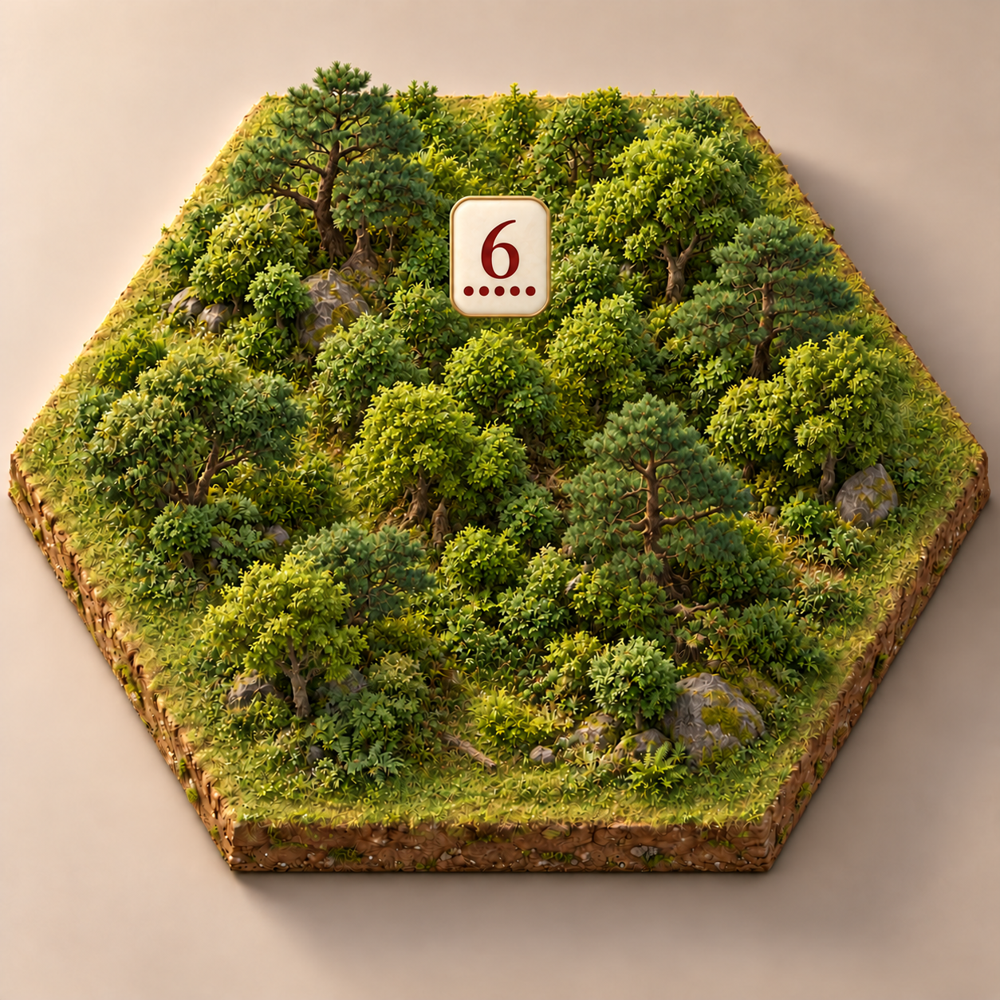

# 森林悬浮点数签原型

日期：2026年10月21日。状态：用户已选定为 ultra 点数外观；运行实现与可读性待验。命中暖金边、地块金线与资源飞行按[实施方案](../../../../../docs/ULTRA_THEME_IMPLEMENTATION_PLAN.md)接入。

中央不再留出数字圆牌空地，林木连续覆盖。暖白薄玉签以细旧金边和暗朱红数字展示示例点数 6，下方为五颗概率圆点。此图仅表达外观；多地块归属、缩放可读性、强盗共存及遮挡仍需游戏内验证。正式数字与概率点应由结构化数据绘制，不将生成图片中的数字作为运行资产。

工具：内置 `image_gen`。基础参考：[v001 森林](../../v001/terrain/forest-v001.png)。最终原图未经裁切或缩放，另存 v002，保留 v001。首稿误生成为四点，经一次定向编辑修正为五点。

## 首稿提示词

用途：游戏美术与信息层的概念原型图。编辑参考图，为《卡坦岛之三国争霸》豪华典藏版ultra展示“完整森林地形＋悬浮薄玉点数签”。保留原图的六角地块轮廓、薄土层底座、米色背景、微缩写实质感、相机角度与暖光。关键改动一：彻底消除中央圆形空地和围成环的树木布局，中心也种植自然的松树、阔叶树、蕨类和灌木，形成疏密错落、连续覆盖地块的完整森林；不要留下任何用于放数字的圆形草坪、平台或地面圆牌。树木前低后高，有可见树干与林下细节。六边及六角维持低矮净空，避免遮挡未来道路建筑。关键改动二：在地块中心的树冠上方悬浮一枚小巧的薄玉点数签，是游戏的独立信息层，正面平行屏幕、清楚可读，显示位置靠画面中央偏上，有树冠与林地在其下方连续延伸。点数签占地块画面宽度约12%至14%，外形为优雅圆角方形略竖长的暖白象牙玉薄片，细旧金边，极轻微厚度和柔软自身阴影，精致、克制、不发光，不要巨大招牌、底座、支架、绳索、对白气泡尖角、光柱、科幻全息。玉牌上只有一个准确的暗朱红色阿拉伯数字“6”，数字下方整齐一排恰好五颗小暗朱红圆点。数字是视觉重点但体积小，牌面简洁无纹饰，五个圆点均匀间隔，禁止其他文字或符号。悬浮牌不要落到地面，不能作为林中的实物石碑。画面是一张完整场景原型，不做对比拼图，不加标题图注或界面边框，不加水印。地块与所有树木完整入画，留足边距。真实微缩植被与简洁玉质游戏信息层协调，画面清晰，没有强景深。

## 修正提示词

精确局部修正：保持输入图的森林、六角底座、背景、镜头、光照、玉牌大小位置和数字6完全不变。唯一改动是玉牌数字6下方的小圆点：当前只有四颗，必须改为恰好五颗暗朱红实心小圆点，等大、等距、水平居中一排：● ● ● ● ●。五颗必须各自分离、清晰可数，不得合并。数字6、五颗点之外不增加文字或符号。保留完整画面。

