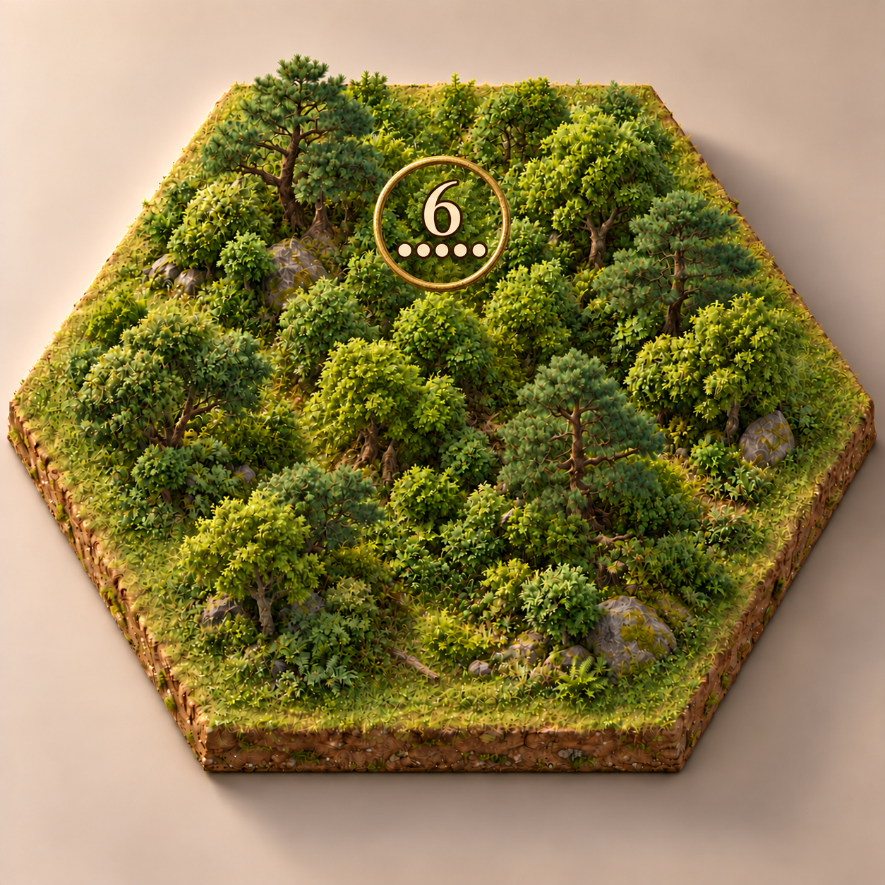
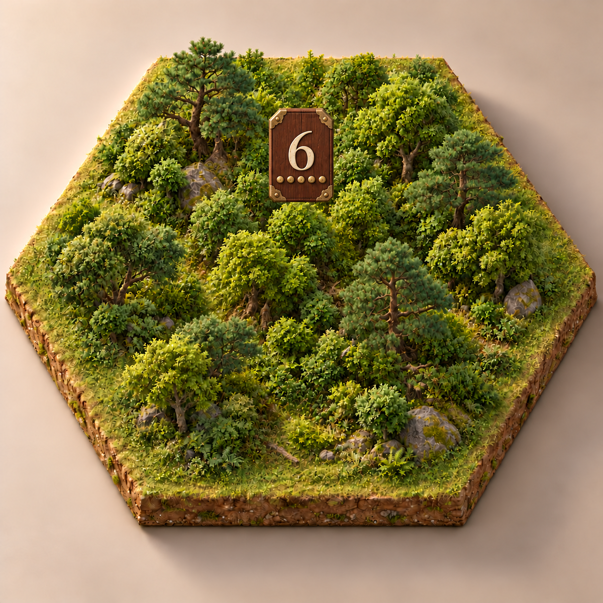
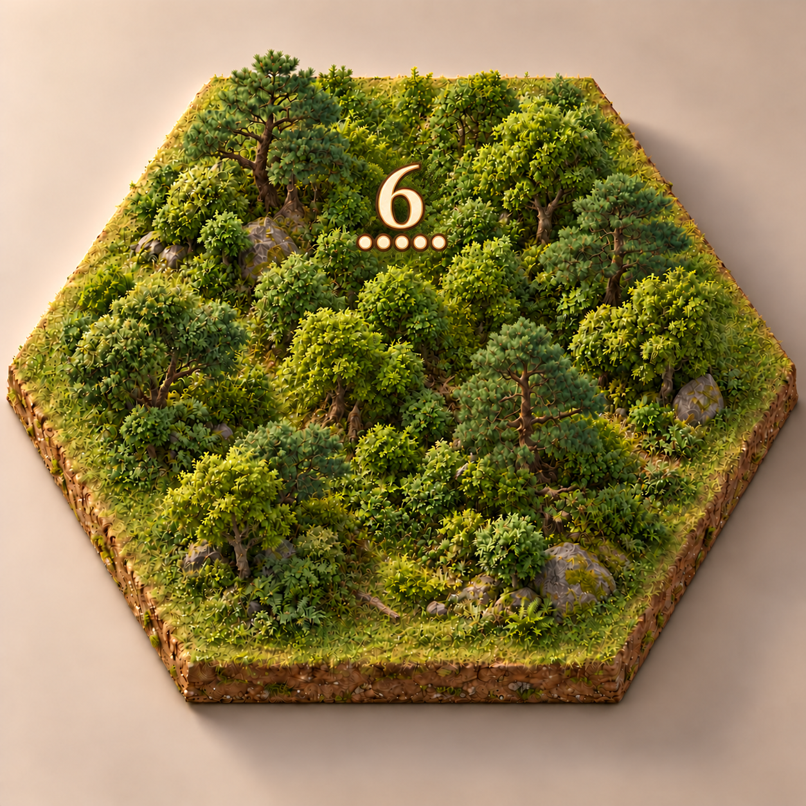

# 悬浮点数显示方案比较

日期：2026年10月21日。状态：本页保留三种探索方案；用户比较后已确定选择原有薄玉签，其他三款不作为当前实施目标。

使用同一完整森林参考、相近视角及暖光，均展示数字 6 与五颗概率点。三张由内置 `image_gen` 分别生成，属于二维概念原型；场景细节和标记尺寸有轻微生成差异，不作为严格的像素级对照。

| 方案 | 设计特点 | 取舍 |
| --- | --- | --- |
| 原有薄玉签 | 暖白底、朱红数字、细金边 | 信息清楚，遮挡一小块森林 |
| A 镂空金环 | 细金属环，内部透出森林 | 兼顾装饰与通透，但外圈占用更大视觉范围 |
| B 三国木签 | 深木纹、旧铜包角、浅色数字与圆钉 | 古朴，明暗对比明确，实体感较重 |
| C 无底板数字 | 暖白数字、金褐描边，取消牌面和外圈 | 遮挡最少，复杂背景与远景下的可读性需重点验证 |

## A 镂空金环

## B 三国木签

## C 无底板数字

## 原有薄玉签

## 来源与检查

- [完整生成提示词](PROMPTS.md)随图保存，图片文件信息与 SHA-256 见[清单](manifest.json)。v001、v002 保留，原始工具输出也保留。
- 已逐张查看森林连续性、悬浮标记、数字 6 与五颗概率点；本轮仅比较标记形态和材质。新方案采用暖白数字，最终 6／8 的高概率强调色尚待统一，不把此次配色视为正式交互规范。
- 生成图片中的数字只作示意，正式 UI 使用结构化数据与排版组件。多地块归属、强盗共存、缩放、移动端可读性及性能均待接入后验证。
- 本轮未修改代码、游戏版本或路线阶段状态。
