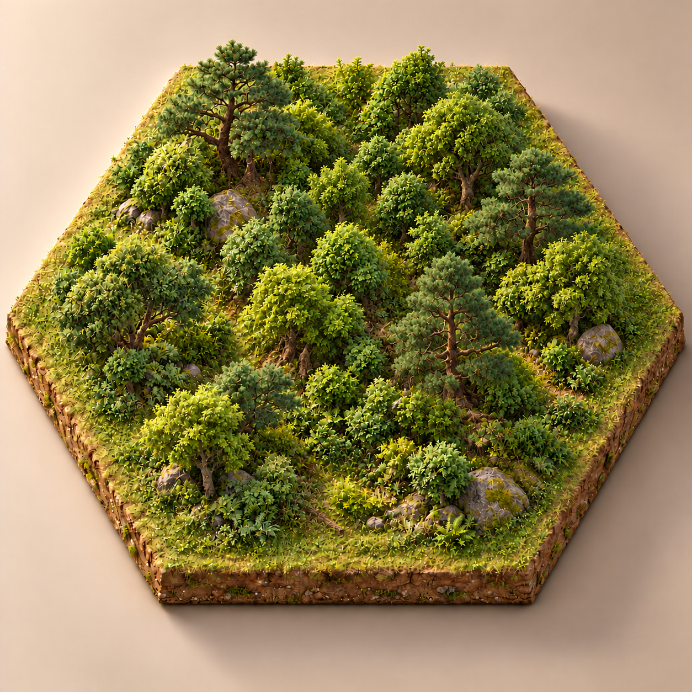
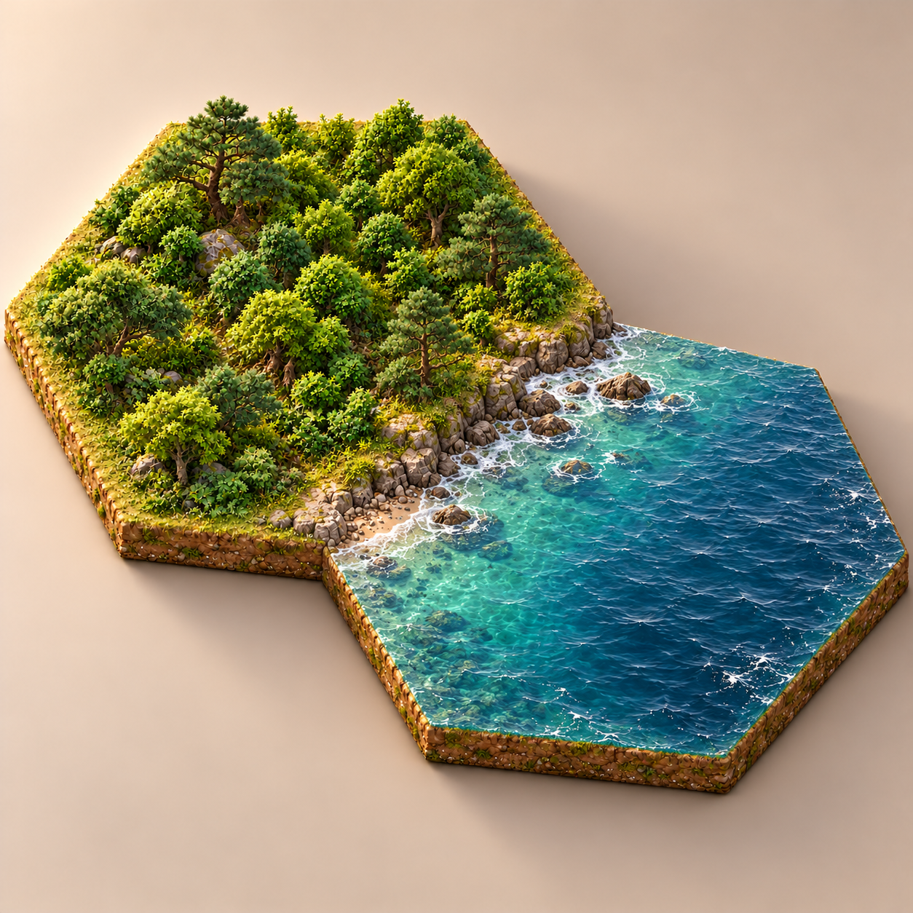
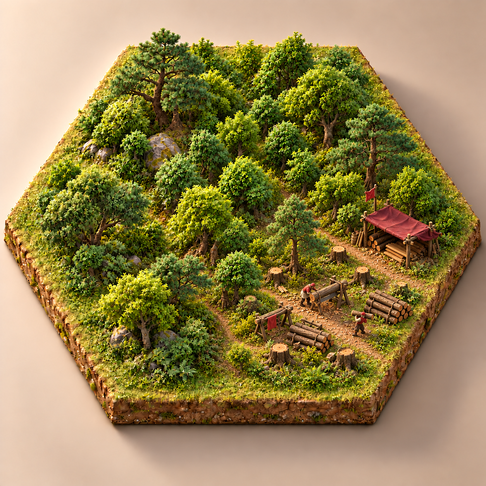
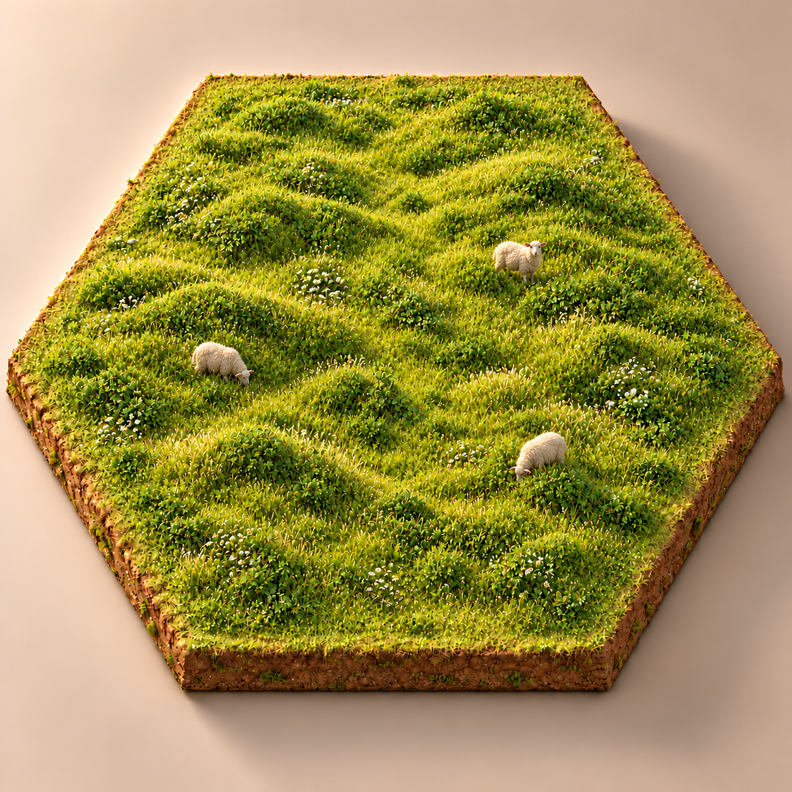
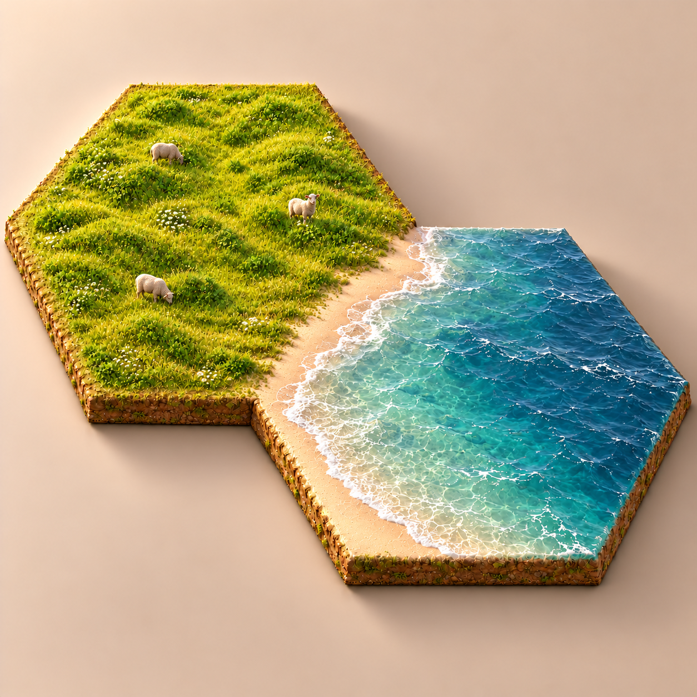
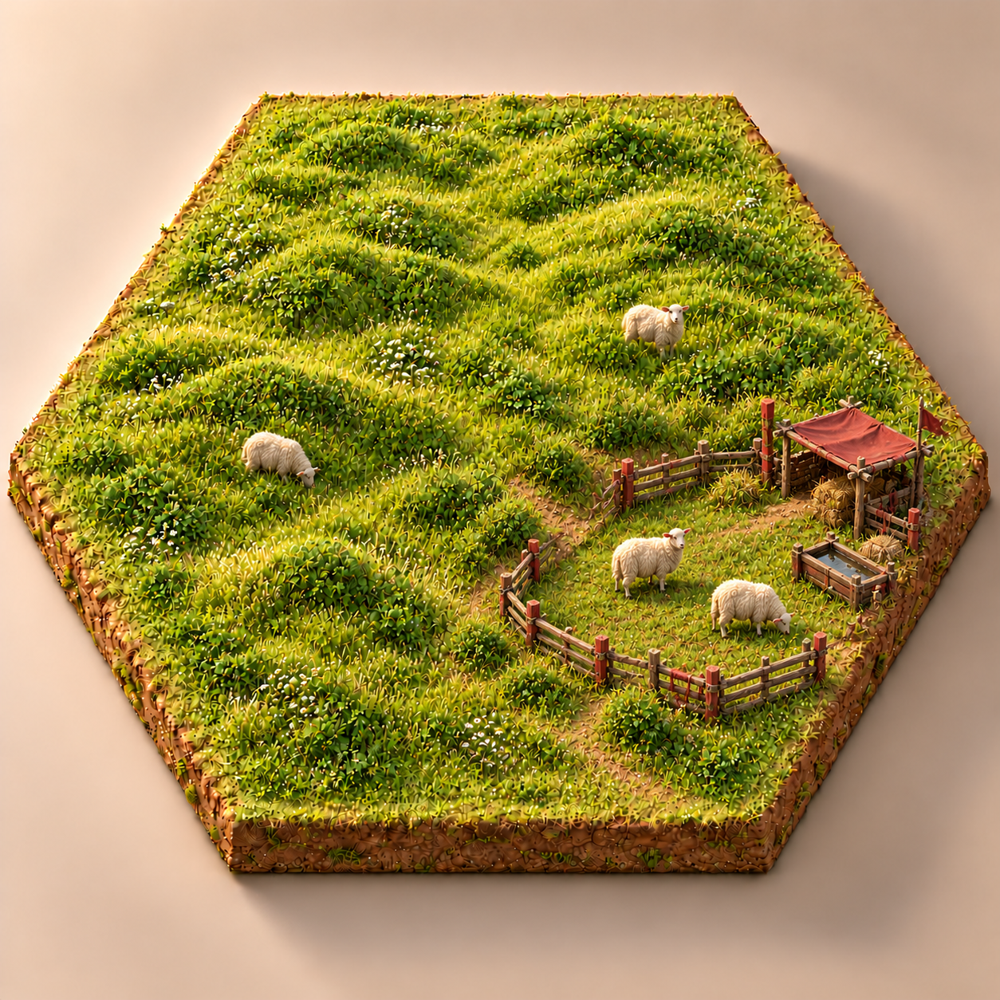
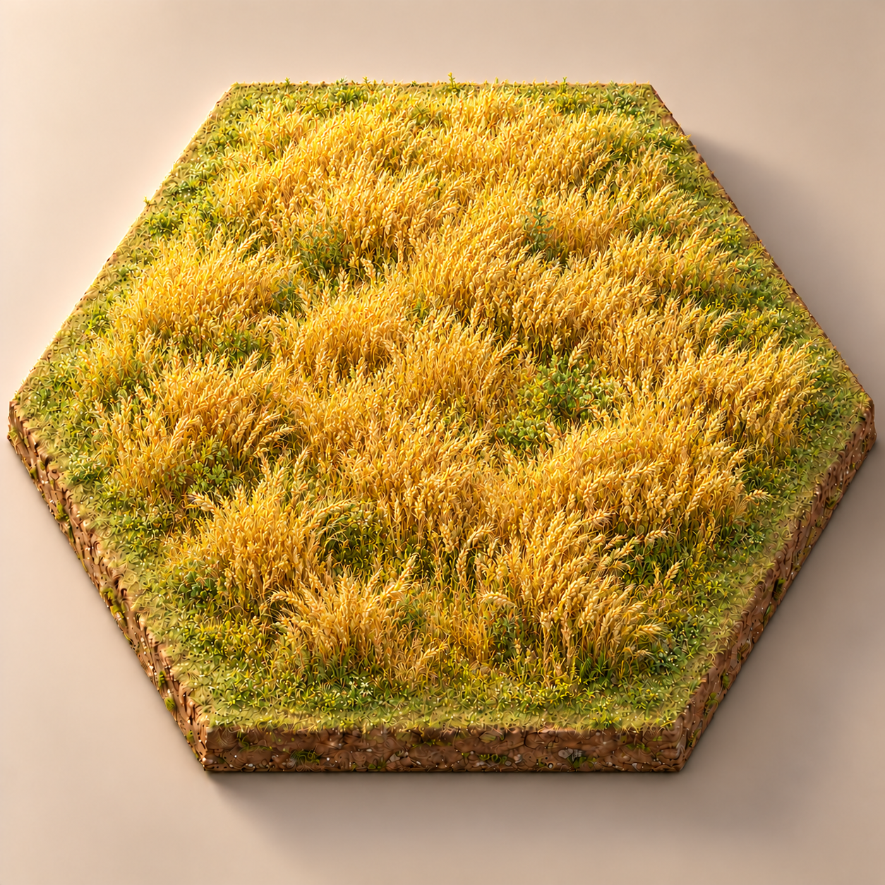
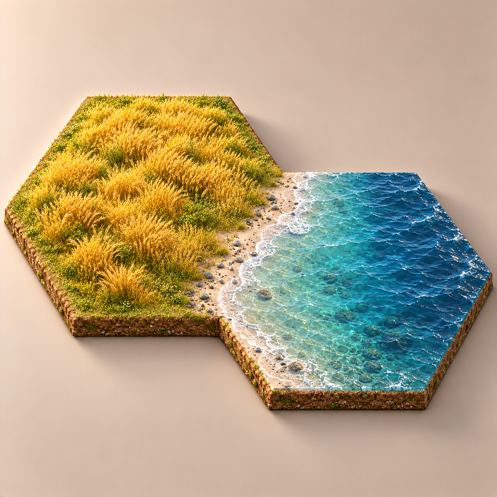
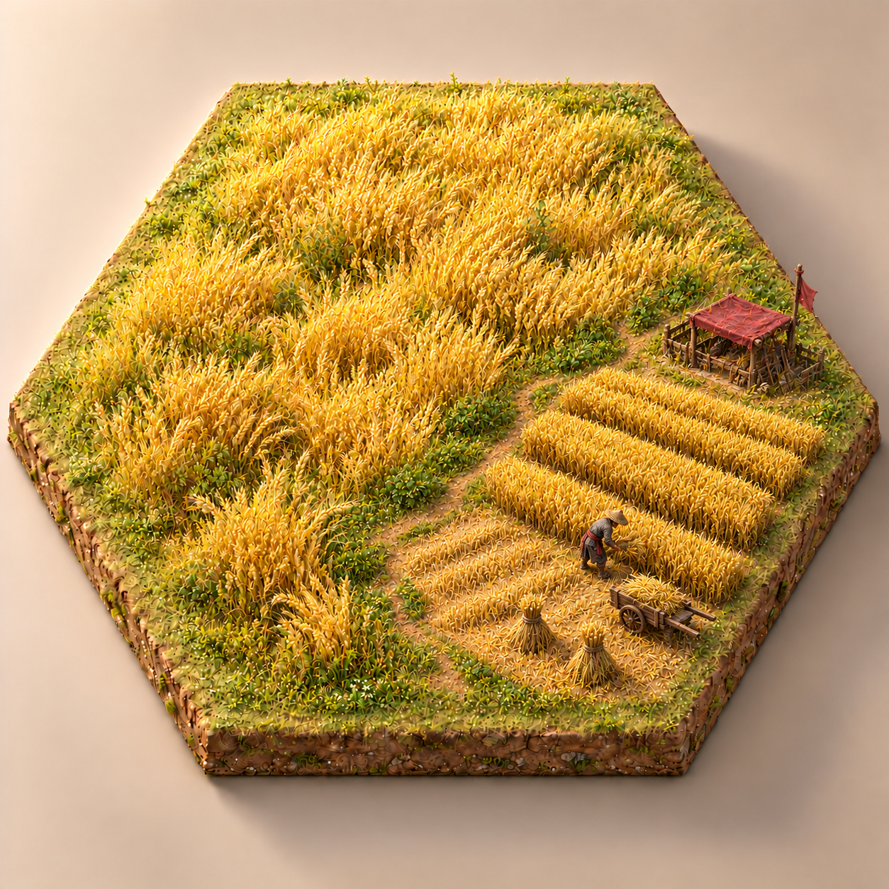

# 森林、草原、麦田三态原型

日期：2026年10月21日。状态：九张二维概念原型已生成，待用户确认；未接入游戏。

本轮只制作板块。悬浮玉牌作为独立组件设计，不出现在图中；地块中央也不留点数空地。草原按用户追加要求去除石头，原始态和海岸态加入少量自由吃草的羊，开发态增加围栏、遮棚和饮水设施。

## 九图对照

点击图片可查看原图。列依次为原始态、海洋接壤态、局部开发态。

| 地形 | 原始态 | 与海洋接壤 | 局部开发 |
| --- | --- | --- | --- |
| 森林 |  |  |  |
| 草原 |  |  |  |
| 麦田 |  |  |  |

## 设计表达

- 森林：原始态为连续林木；临海以低岩岸、岩脚和少量卵石滩过渡；局部开发为树桩、原木、锯架与木材棚。
- 草原：无地表散石，原始及海岸图各有三只羊；海岸以细沙和浅水过渡；开发图保留少量羊，局部加入木栏、红布遮棚和木槽。
- 麦田：原始态用未分行的天然谷草与野生麦穗表现；海岸经低草带进入沙滩；局部开发为整齐麦垄、收割短茬、麦束、手推车和农具棚。
- 局部开发以右前方约三分之一为构图目标，其他区域保留自然态。用暗朱红棚布、旗帜与设施点缀示范玩家配色，不将整片地表染红。图片只显示生产景观，没有叠加独立村庄或城市棋子。
- 海岸图各包含一块陆地与一块相邻海洋，展示接壤方向；本批不制作港口与商船。九图统一暖光、微缩质感和近似斜俯视视角。

## 来源、检查与待验

- 使用内置 `image_gen`；完整首稿和修正提示词见[生成记录](PROMPTS.md)，参考关系、文件尺寸及 SHA-256 见[清单](manifest.json)。v001 至 v003 原图保留。
- 已逐张查看地形类别、原始／海岸／开发区别、无玉牌点数、草原去石加羊及开发区配色，并核对文件落盘和本地引用。
- 开发面积、六角精确边长、道路净空和海岸共享边尚未通过模型测量；生成图中的扇区、海岸底座与尺寸存在视觉近似，不可据此认定三分之一面积或模块拼接已验收。
- 后续建模需校准生产区朝建筑角点的方向、相邻多玩家区域、连续道路过渡带、海平面与海岸接缝，补齐顶视、侧视和拥挤节点预览，并验证羊群与工人动画、双端性能。
- 对应[主题实施方案](../../../../../docs/ULTRA_THEME_IMPLEMENTATION_PLAN.md)。本次不改变 U2 阶段完成状态，不修改代码、版本或构建。
