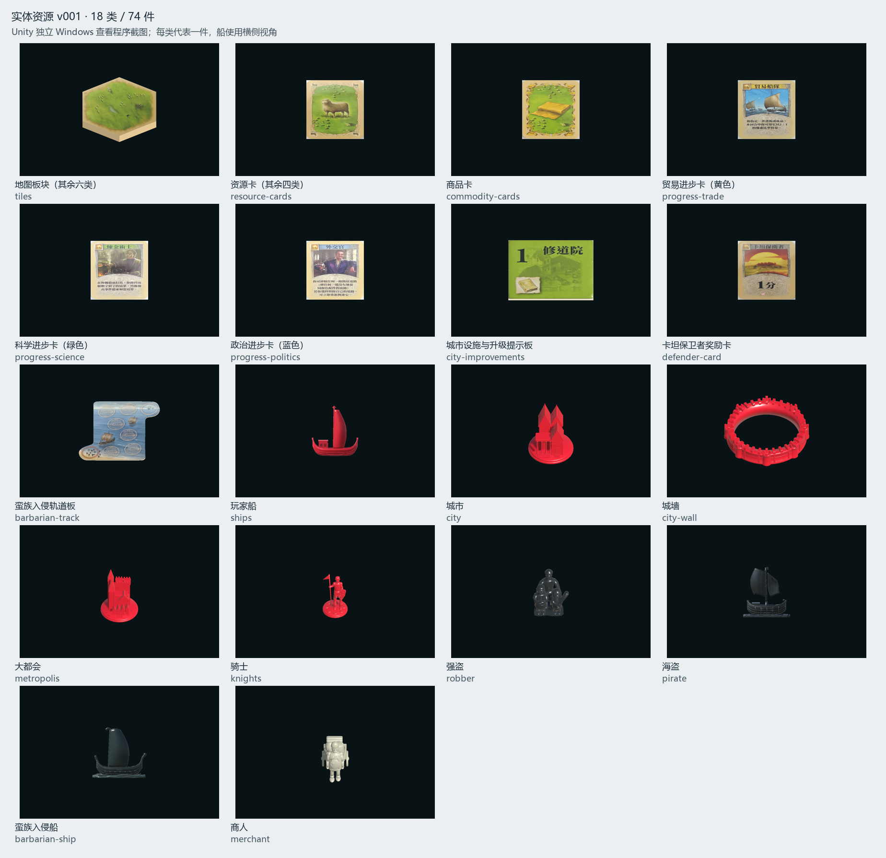

# 实体美术转化 v001 交付与验证

2026-10-09，本轮按[美术转化清单](ART_CONVERSION_CHECKLIST.md)逐类派发独立子任务，完成 **18 类、74 件新资产**。用户既有森林板块、木头资源卡、村庄、道路四类实验样板单独保留。清单由实际源文件、导出、回读、干净重建及 Unity 记录刷新，每类交付后均更新进度。

平面资产采用用户确认的原照片校正路线：记录角点，重投影原始像素，保留原版插画、文字、曝光、反光与模糊。棋子采用照片引导的参数化三维网格；船、城墙、骑士、商人及三人强盗群像均有实际 `.blend` 和 `.fbx`，没有将生成位图宣称为三维模型。98 张原始 JPEG 的 SHA-256 全部与锁定清单一致。



## 实际运行结果

| 检查 | 结果与证据 |
| --- | --- |
| 原照片与交付覆盖 | 98 原件未变；18 类型、74 唯一 ID；75 个校正 PNG 依赖。[跨类型审计](verification/entity-conversion-v001/pipeline-audit.json)核对源文件、配方、脚本、FBX、纹理和预览校验值 |
| Blender 生成与 FBX 回读 | 18 类通过；实际检查闭合边、非退化三角面、UV、材质槽使用、底心轴心、尺度、来源与依赖。每类 README 和 `verification.json` 从清单进入 |
| 干净目录重建 | 18 类通过；比较几何、UV、材质、纹理、参考与导出参数，不要求 BLEND/FBX 二进制逐字节相同。每类 `clean-rebuild-verification.json` 保留证据 |
| Unity 导入与构建 | Unity **6000.3.25f1** 导入 74 件，实际包围盒与三角面数匹配；显式绑定 URP 材质和 PNG。[导入记录](verification/entity-conversion-v001/unity-import.json) |
| 独立 Windows 程序 | 74 件逐件加载、材质与无碰撞体检查，旋转和翻面方法调用通过；156 张 URP 截图。[运行报告](verification/entity-conversion-v001/player-verification.json) |
| 城墙组合 | 城市和大都会在当前估算居中几何中均有约 **0.297 mm** 最小径向余量；查看程序另拍两个组合。[源几何净空报告](verification/entity-conversion-v001/assembly-clearance.json) |
| 规则回归 | **496/496 通过，0 失败、0 跳过**；未新增镜像外观实现的规则测试。[成功 TRX](verification/entity-conversion-v001/rules-regression.trx) |

使用 Blender **4.5.14 LTS**；照片工具为 Python **3.12.14**、Pillow **12.3.0**、NumPy **2.3.5**。照片处理工具版本、脚本/配方 SHA 和角点保存在每类 `texture-correction.json`。再次生成已有贴图时已验证内容逐字节相同；内容不同的版本默认拒绝覆盖。

Windows 156 张检查图包括：74 件逐件俯视图、每类代表件的四视图（72 张）、八类代表背面以及城市/大都会装入城墙的两张组合图。旋转翻面检查采用运行时方法调用，未模拟鼠标点击全部按钮。

## 已实际看图的范围

各类型子任务均查看自己的原照片、校正贴图及 Blender 四预览，限制写入对应 README。主任务另外实际查看全部 74 件 Unity 俯视图、八类背面、两个组合和类型总览；卡面标题方向、插画、六角边界、异形轨道轮廓、四船配色和中性未知背面可核对，未发现空图、反向文字或缺失材质。资源/科学/贸易背面均为正向；设施翻板保留对应背面的插画。

逐件俯视联系图：[1](verification/entity-conversion-v001/all-assets-top-01.png)、[2](verification/entity-conversion-v001/all-assets-top-02.png)、[3](verification/entity-conversion-v001/all-assets-top-03.png)、[4](verification/entity-conversion-v001/all-assets-top-04.png)；[背面与组合](verification/entity-conversion-v001/backs-and-assemblies.png)。原始运行截图在 `verification/entity-conversion-v001/assets/<资产ID>/unity-top.png` 以及各类型目录内，联系图的缩放不代表原截图分辨率。

独立审查子任务另实际查看全部 18 类的游戏相机、侧视和相邻环境图（54 张），并打开船侧视、城墙组合、骑士/大都会/商人相邻图及商人近景复核。未发现空图、缺材质、明显错贴或严重遮挡。[代码与视觉审查记录](verification/entity-conversion-v001/code-review.md)保留审查范围和限制。

## 运行与复现

从项目根目录执行：

```powershell
# 打开已构建的查看程序：类型选择、上一件/下一件、旋转、翻面、四视角、城墙插装。
powershell -NoProfile -ExecutionPolicy Bypass -File tools/development/Play-EntityAssets.ps1

# 重新导入版本产物并构建 Unity 查看程序。
powershell -NoProfile -ExecutionPolicy Bypass -File tools/development/Build-EntityAssets.ps1
powershell -NoProfile -ExecutionPolicy Bypass -File tools/validation/Test-EntityAssets.ps1

# 从尚不存在的空目录重建某一类，与冻结的 art 正式输出比较。
powershell -NoProfile -ExecutionPolicy Bypass -File tools/art/Build-EntityAssets.ps1 -Type merchant -OutputRoot .local/art-pipeline/rebuild/merchant-next -SkipPreviews -CompareRoot art
```

通用生成器拒绝覆盖已有版本模型。改变外观、尺寸或贴图时应创建新的版本，不应把已存在的 `art` 目录当作清空重跑的临时目录。源文件、导出、预览、配方分列在 `art/{source,exports,previews,recipes}/entity-conversion-v001/<类型ID>/`。

规则回归使用项目固定 .NET SDK **10.0.401**，实际成功命令如下；使用缓存依赖，临时关闭在线 NuGet 漏洞索引查询，这不是依赖安全审计：

```powershell
. ./tools/development/Enter-DevEnvironment.ps1
$env:VSTEST_CONNECTION_TIMEOUT='180'
& $toolchain.dotnet test tests/Catan.Rules.Tests/Catan.Rules.Tests.csproj -c Release --no-restore --disable-build-servers -m:1 -p:NuGetAudit=false --results-directory .local/art-pipeline/rule-regression --logger 'trx;LogFileName=art-rules-verified.trx' --logger 'console;verbosity=minimal'
```

## 仍保留的待验项

尺寸、颜色与单照隐藏面仍为工作估算，尚无实测或用户最终外观确认。未知背面用明确中性材质；缺少的山地照片、数字盘、港口、海框、骰子、基础发展卡及扩展标记等均在清单单列。骑士有无头盔与激活状态的映射只是候选，俯视下三级旗形不易区分；原照文字仅作美术数据，不改规则。

图库只读取公开美术目录，没有把这 74 件全面替换进各玩法的规则驱动视图，也没有验证整桌实例数量、全部玩家配色、拾取、碰撞、长局性能、LOD 或目标硬件。Blender 的 `crowded-vertex` 是类型陈列图；Unity 相邻图使用单块森林、道路与村庄作参照，不能提升为整桌节点交互验收。FBX 回读验证 UV 存在/有限，未逐角签名比对回读 UV；本轮结合实际 Unity 看图检查。

本交付是实体美术转化批次，未满足路线图 M8 的完整资产、长局性能和发布退出条件，因此保留现有阶段状态；未修改 `ROADMAP.md` 的开发进度。已有实验样板和此前工作区改动均保留，未将本批次与其混合提交。
