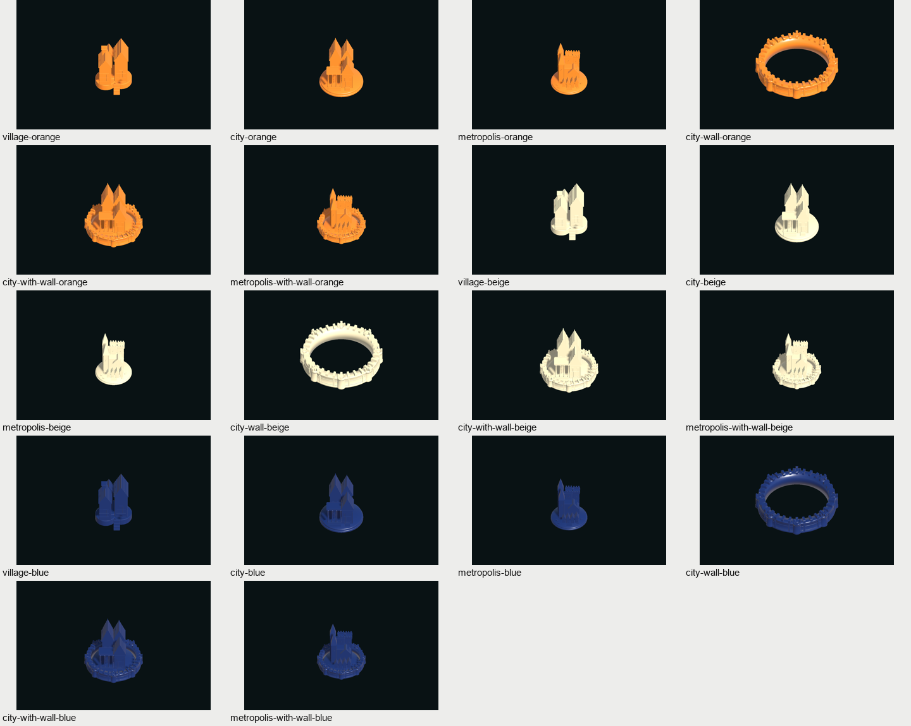
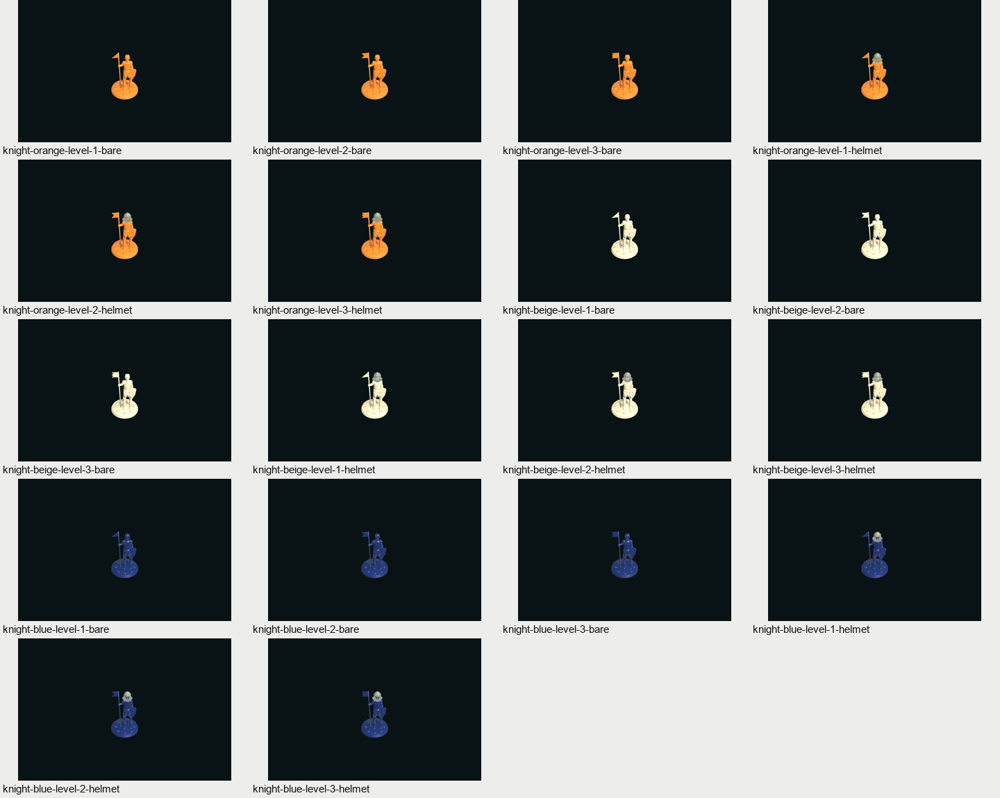

# 三色玩家组件美术追加批次 v002

2026-10-10，将本次已分类的橙色、米色、蓝色 36 张实体照片转为 **36 件实际三维资产**，并接入基础版、航海家、城市与骑士及双扩展的游戏显示。每色包含 6 种骑士（三级 × 戴盔/无盔），以及村庄、城市、大都会、独立城墙、城市+城墙、大都会+城墙 6 种建筑资产。

照片用于参数化建模的轮廓和颜色参考。本批次有 36 件模型 `.blend`、36 件显式 `.fbx`、独立程序材质、Unity 预制体、配方和验证记录；没有把照片或生成位图当成三维模型。原图与原文件名备份保持原始字节，[归档清单](../assets/references/catalogs/player-components-v001.json)记录全部 36 个来源和 SHA-256。旧版 v001 保留，新增产物另存 `entity-conversion-v002`。





## 游戏接入

实际对局按公开玩家席位选择模型：P1 红色沿用已有 v001，P2 蓝色、P3 橙色、P4 米色使用本批次资产。基础版和航海家显示新村庄、城市；城市与骑士及双扩展显示骑士、城墙、大都会和相应组合。组合使用一个中立根对象，避免在带墙城市或大都会下面重复叠加普通城市。

资产根保持米制、缩放 1 和底面中心轴心；朝向与图库一致，正面朝向默认游戏相机。预制体不加碰撞体，原有绿色/红色落点预览保留。规则验证、权威存档和玩家权限没有修改，显示只接受公开视图投影。

骑士保留独立的等级点数和激活状态标记；头盔与激活的对应关系仍是暂定美术约定。大都会保留三轨道颜色与一/二/三点标记，不把玩家色当作轨道身份。灰绿头盔使用独立材质，不随玩家色替换。

## 已运行的验证

| 检查 | 结果与证据 |
| --- | --- |
| 来源与资产清点 | 36 张归档照片和 36 张原文件名备份哈希一致；两个类型各 18 件唯一资产。[批次审计](verification/entity-conversion-v002/pipeline-audit.json) |
| Blender 生成及 FBX 回读 | Blender 4.5.14 LTS；全部 36 件检查真实网格、底心、包围盒、闭合边、非退化三角面、UV、材质槽与来源。[骑士](../art/exports/entity-conversion-v002/player-knights/verification.json)、[建筑](../art/exports/entity-conversion-v002/player-buildings/verification.json) |
| 干净目录重建 | 两类各 18/18 通过，严格比较几何/UV 签名、材质、参考和导出参数；不要求 FBX/BLEND 二进制逐字节相同。每类 `clean-rebuild-verification.json` 保留证据 |
| 城墙组合净空 | 三色城市与大都会共 6 个组合通过独立部件几何/UV 一致性和孔净空检查；当前估算单侧余量约 0.2972 mm。[组合报告](../art/exports/entity-conversion-v002/player-buildings/insert-clearance.json) |
| Unity 导入与 Windows 构建 | Unity 6000.3.25f1；36 件实际包围盒、三角面数、URP 材质和无碰撞体检查通过。新图库与实际 M6 程序均构建成功。[导入记录](verification/entity-conversion-v002/unity-import.json) |
| 独立图库程序 | 36 件全部加载、旋转/翻面方法检查及每件四视图通过，共 144 张 URP 截图。[运行记录](verification/entity-conversion-v002/player-verification.json) |
| 实际渲染入口 | 基础/M3 各 8 个，M4/M5 各 44 个，共 104 个公开数组投影实例；同一入口用于真实 PlayerView。核对来源 Mesh/Material 引用、唯一组合根、缩放 1、朝向、无碰撞、等级/激活/轨道标记及合法预览颜色，另输出 8 张截图。[渲染记录](verification/entity-conversion-v002/player-components-verification.json) |
| M6 实际对局进程 | 两个独立 Windows 进程验证四类规则包的混合人类/AI 回合、暂停、玩家权限、自然交易、保存恢复及继续 AI 行动。权威测试存档仅保留在忽略的 `.local`，公开证据只记录成功元数据。[运行记录](verification/entity-conversion-v002/m6-smoke.json) |
| 规则回归 | 496/496 通过，0 失败、0 跳过；未新增仅镜像外观实现的规则测试。[TRX](verification/entity-conversion-v002/rules-regression.trx) |

实际人工看图：子任务查看全部来源与两类 Blender 四视图；主任务查看全部 36 件 Unity 游戏相机与俯视联系图、M4/M5 公共陈列相机及组合近景。首次发现默认相机看到模型背面，修正朝向后重新构建并运行相同检查。颜色、独立头盔、组合形体和标记可辨；深蓝在暗光下对比较低。未把截图自动生成等同于逐张人工看过所有 144 张原尺寸图片，也未模拟鼠标点击全部图库按钮。

## 查看与复现

在项目根目录运行：

```powershell
# 实际游戏已重建；在城市与骑士或双扩展中查看骑士、城墙和大都会。
powershell -NoProfile -ExecutionPolicy Bypass -File tools/development/Play-M6.ps1

# 独立检查三色36件资产、旋转、翻面和四视角。
powershell -NoProfile -ExecutionPolicy Bypass -File tools/development/Play-PlayerComponents.ps1

# 从已有冻结产物重新导入并构建图库及 M6。
powershell -NoProfile -ExecutionPolicy Bypass -File tools/development/Build-PlayerComponents.ps1
powershell -NoProfile -ExecutionPolicy Bypass -File tools/validation/Test-PlayerComponents.ps1

# 从尚不存在的目录重建并比较，不覆盖正式版本。
powershell -NoProfile -ExecutionPolicy Bypass -File tools/art/Build-PlayerComponents.ps1 -Type player-knights -OutputRoot .local/art-pipeline/rebuild-v002/knights-next -SkipPreviews -CompareRoot art
```

源/导出/预览/配方在 `art/{source,exports,previews,recipes}/entity-conversion-v002/{player-knights,player-buildings}`。Unity 模型在 `Assets/Art/EntityAssets/v002`，运行预制体在 `Assets/Resources/EntityAssets/v002`。生成工具拒绝覆盖已有版本；变更形体或颜色应新增版本。每类配方说明：[骑士](../art/recipes/entity-conversion-v002/player-knights/README.md)、[建筑](../art/recipes/entity-conversion-v002/player-buildings/README.md)。

## 待确认的范围

尺寸、程序颜色、未知背底面和单照隐藏结构仍是估算与简化，不是扫描或精确复制。建筑沿用已有估算比例，外形较原照的矮圆轮廓修长；需要实测与多角度参考才能修正。骑士旗形在正俯视不易读，因此保留独立等级点数。新库合计 545,580 三角面，包含三色和独立/组合重复资产，不代表同时显示的整局预算。

本批次没有完成用户最终外观验收、全部实体资源、LOD、长期对局性能、目标硬件预算、音效、教程或发布验证。公共陈列夹具证明显示入口选对模型，不能替代正常整桌节点交互和长期性能验收。本次未满足 M8 退出条件，路线图阶段状态不变；既有工作区修改保留。
