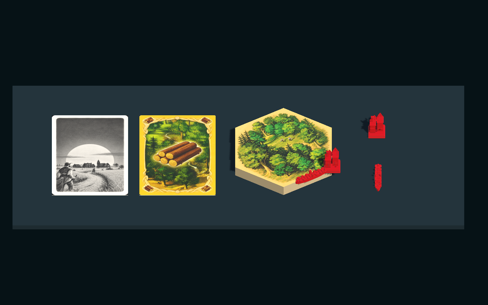
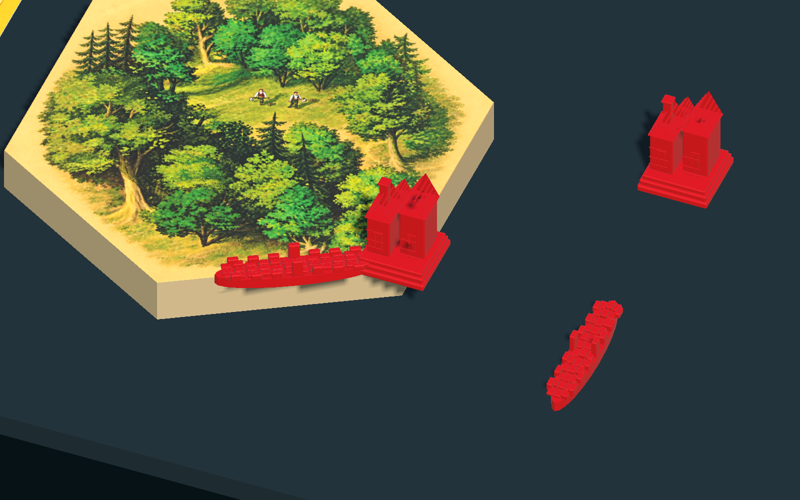

# 实体照片第一批样板 v001

2026-10-09，按用户要求完成木头资源卡正反面、森林板块、道路和村庄的首批样板。目标是将真实参考、可编辑源文件、导出、Unity 使用和预览连起来。本次不是 M8 完成验收，也不替用户确认最终外观。

## 查看和试玩

在项目根目录执行：

```powershell
powershell -NoProfile -ExecutionPolicy Bypass -File .\tools\development\Play-PhotoSamples.ps1
```

程序为 `.local/art-photo-samples/Builds/Windows/CatanArtSamples-v001.exe`。首屏显示卡牌两面及三件组件，可切换斜视、俯视、侧视和交点近看，旋转道路与村庄、翻牌、切换红蓝色。点击“进入游戏试玩”进入 M6 规则菜单。样板陈列不会写入游戏局面。

此程序内四种规则模式均使用新的森林板块、道路和定居点；城市和船保留原来的组件。基础版和航海家手牌面板的木材格使用卡面缩略图，数量仍来自当前玩家的 PlayerView。卡牌背面和完整双面 3D 卡片在样板场景中展示；本批没有改造成完整的 3D 手牌操作系统，也没有替换其他四种资源卡。

现有 `.local/m6` 程序保留本次之前的构建。要查看这一批，请使用上述专用启动入口，而不是旧的 M6 可执行文件。新资产也已放入 Unity 工程，可以使用 `Assets/PhotoSamples-v001.unity` 打开样板场景。

## 输入和输出

| 样板 | 原始参考 | 成品 |
| --- | --- | --- |
| 木头资源卡 | `assets/references/inbox/资源牌/木头.jpg`、`资源牌背面.jpg` | `wood-front.png`、`resource-back.png`、双面 `resource-card.fbx` |
| 森林板块 | `assets/references/inbox/地图板块/森林.jpg` | 带顶面 UV 和纸板侧面的闭合 `forest.fbx`，顶面贴图 `forest-top.png` |
| 道路 | `assets/references/inbox/道路/红色道路.jpg` | 闭合底座、浮雕石块和路缘组成的 `road.fbx` |
| 村庄 | `assets/references/inbox/建筑/红色村庄.jpg` | 台阶底座、成组坡屋顶房屋、烟囱及浅浮雕组成的 `village.fbx` |

原图内容与文件名不变，五个来源在 `assets/references/manifest.json` 中登记，SHA-256 随导出清单保存。来源版本仍未知，没有把印刷内容当成新的规则依据。

- Blender 可编辑文件：`art/source/photo-samples-v001/*.blend`。
- 冻结的图片生成输出：`art/source/photo-samples-v001/textures`。
- 配方和图片提示词：`art/recipes/photo-samples-v001/recipe.json`、`imagegen.json`。
- FBX、贴图、清单与回读报告：`art/exports/photo-samples-v001`。
- Blender 四视图：`art/previews/photo-samples-v001`。
- Unity 模型、材质和合并网格：`Unity/Catan/Assets/Art/PhotoSamples/v001`。
- Unity 预制体和卡面图片：`Unity/Catan/Assets/Resources/PhotoSamples/v001`。
- Windows URP 渲染及验收日志：`docs/verification/photo-samples-v001`。

## 还原程度与尺度

图片使用内置 `image_gen.imagegen`，按三份照片分别进行清理；提示词要求保留卡框、木头与森林插画、灰度村庄背面、森林空地和伐木人物。生成结果实际重新解释了插画细节，因此标记为 **AI 清理候选，不是逐像素扫描复刻**。不从生成文字或图标推导规则。原照片可继续用于后续精确校正方案。

道路和村庄是根据可见轮廓制作的参数化近似网格，不是单张照片的精确三维扫描。背面、底面和实测尺寸仍未知。森林原物是平面印刷板块，所以本批保留印刷外观，贴在有厚度的六边形网格上；没有把森林贴图声称为立体树林。

全部尺寸标为估算：板块边长 40 mm、厚度 8 mm，网格外缘留 0.4 mm 拼接缝；道路 26 × 5 × 5 mm；村庄占地 12 × 12 mm、高 16 mm；卡牌 54 × 80 mm、厚 0.3 mm。单位为米。预制体根节点底心归零，道路长度沿 Unity Z 轴。模型导入保留 FBX 轴转换，额外记录展示朝向以面对默认相机。道路和村庄在 Unity 合并为各一个渲染网格，避免几十个细节分别增加绘制调用。

地图地块、道路和建筑的位置仍取自稳定 Tile/Edge/Vertex ID。渲染网格没有规则碰撞职责。城市与船显式不使用本批定居点和道路预制体，避免升级缩放或船桅杆继承不合适的尺寸。

## 可复现和验证

新目录重建全部模型与四视图：

```powershell
powershell -NoProfile -ExecutionPolicy Bypass -File .\tools\art\Build-PhotoSamples.ps1 -OutputRoot .local\my-photo-rebuild -CompareRoot art
```

已有完成清单的输出目录会拒绝覆盖。图片模型输出具有生成随机性，无法承诺重新请求同一提示词得到相同像素；重建使用版本内冻结的三张 PNG，检查其校验值，再确定性生成网格和导出。

Unity 构建与独立 Windows 检查：

```powershell
powershell -NoProfile -ExecutionPolicy Bypass -File .\tools\development\Build-PhotoSamples.ps1
powershell -NoProfile -ExecutionPolicy Bypass -File .\tools\validation\Test-PhotoSamples.ps1
```

实际验证包括：四个 FBX 在新 Blender 进程中的回读、闭合性、非退化三角形、UV、底心轴心、估算尺寸；原照片校验值；干净输出目录的几何、材质和纹理一致；Unity 6000.3.25f1 导入后的实际边界和显式 URP 材质绑定；Windows 程序中的四个预制体、正反面贴图、旋转、翻牌和换色；四份 URP 相机渲染；四种规则模式的混合人类/AI 行动及独立进程保存恢复。

本次未修改规则，没有增加或重新宣称完整规则测试数量。实际窗口鼠标点击没有进行；按钮逻辑由独立程序直接调用检查，渲染图逐张检查。用户视觉确认、实体尺寸复核、隐藏表面细化和长时间性能仍待进行。



