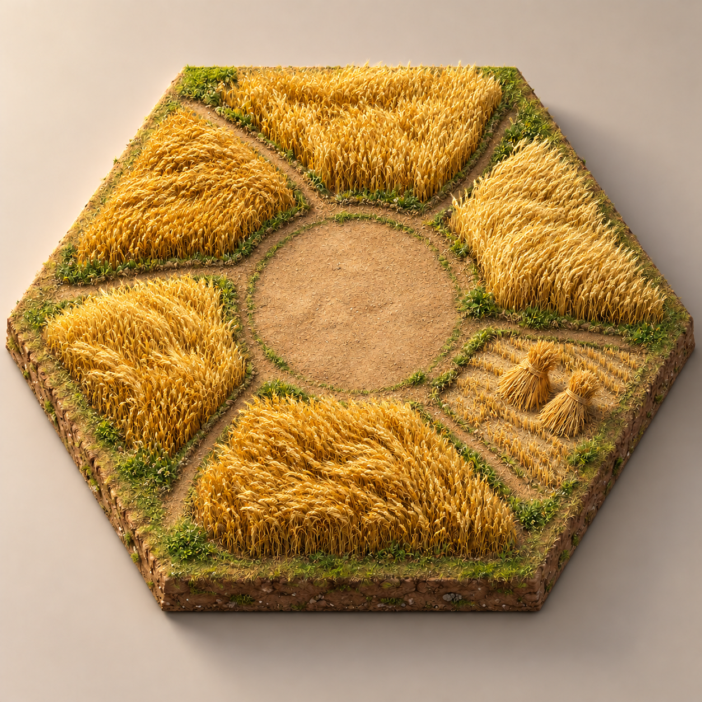

# 豪华典藏版ultra主题实施方案

2026-10-22：Ultra 开发已搁置，本分支仅归档既有成果；恢复需用户明确指示。后续常规开发使用 dev-2.0。

日期：2026年10月21日。状态：U0 的PC性能归因与逐棋子覆盖已补齐（1.7.1），Android真机待验；U1 双主题基础已实现（1.7.2），实机与人工交互待验，见 [U1 记录](verification/ultra/U1-themes.md)；U2 首个草原／薄玉牌可玩切片已实现（1.7.3），样板外观及后续地形待验，见 [U2 记录](verification/ultra/U2-pasture.md)；U2 进行中，U3及后续待开始。适用平台：Windows、Android。实际结果见 [U0 基线记录](verification/ultra/U0-baseline.md)。

本次升级新增可切换主题「豪华典藏版ultra」，现有外观主题正式命名为「真实桌游」。两者共用规则、地图、AI、存档及联机协议；ultra 负责立体微缩地形、环境动态与对应光照材质。玩家可以继续使用真实桌游，也可以在同一局游戏中切换至 ultra。

实施顺序为：性能基线 → 双主题基础 → 静态三维样板 → 植被海洋动态 → 羊群与船只 → 工坊港口 → 道路人流 → 全地图覆盖 → 全牌面重绘与接入 → 双端验收。牌面清单在 U0 建立，代表牌样板在 U2 确认，完整牌面在 U7A 收口。每一步保持游戏可玩，满足本步骤退出条件后再扩大范围。

## 一 已确定目标与范围

### 主题约定

| 项目 | 真实桌游 | 豪华典藏版ultra |
| --- | --- | --- |
| 定位 | 延续现有实体桌游组件与照片来源外观 | 暖光下的精细三国微缩沙盘 |
| 内部标识建议 | `tabletop` | `ultra` |
| 地形 | 保留现有资产及表现 | 新建有真实高度、侧面和细节的三维资产 |
| 动态 | 保留已有操作反馈 | 在操作反馈基础上增加环境生活动态 |
| 品质选择 | 沿用现有设置 | 低、中、高画质，另设环境动态开关 |
| 使用关系 | 原主题独立可用 | 新主题独立可用 |

主题与画质是两个设置。ultra 低画质仍呈现 ultra 的模型与风格，不能通过悄悄切换到真实桌游来实现降级。首次升级默认保留真实桌游，玩家主动选择 ultra；本地保存选择，各联机客户端可以使用不同主题。

菜单增加两个准确的主题名称与预览。棋盘、桌面、灯光和相关三维组件按主题切换；卡牌规则文字、费用、数字、玩家颜色和功能入口保持一致。菜单背景美术可在棋盘通过样板验收后追加，不作为第一步的依赖。

### 内容范围

- 2026年10月21日确认采用悬浮薄玉牌点数；命中时玉牌暖金边与地块柔和金线联动，实际产出的资源从地块飞向对应玩家。
- 陆地无相邻建筑时保持原始自然状态；有村庄或城市后仅开发对应三分之一区域，形成该地形的生产设施，并采用建筑所属玩家的配色风格。地块保留中性边缘用于接壤过渡与修路。
- 海洋上的港口按实际港口类别制作特色码头，装饰商船从随机可达的海洋地图外缘驶入，靠港装卸后离开；陆海接壤处制作沙滩或悬崖过渡。
- 真实三维地形：麦田、森林、牧场、矿山、砖土丘陵、沙漠、海洋、金矿。
- 持续环境动态：麦浪、树木摇动、羊群活动、采矿、制砖、海浪、港口装卸、船只摇曳、道路行人和运货。
- 扩展组件：船、海盗、骑士、城墙、大都会、商人、蛮族船及已有剧本特殊组件，按当前规则含义保留识别性。
- 覆盖基础版、航海家、城市与骑士、当前支持的组合剧本；不借本次主题开发扩充规则或新增剧本。
- 原图作为风格参考，正式模型必须可从顶视、侧视及游戏镜头观察；生成位图不得充当三维模型交付。
- 基础版、航海家、城市与骑士及组合模式的所有牌面全部纳入 ultra 重绘，包括资源牌、基础发展牌、进步牌、商品牌、分值牌、奖励牌、说明牌及剧本专用牌；同步制作牌背、边框、图标和各界面缩略图。真实桌游继续使用原牌面。

不在首轮范围：完整居民经济模拟、真实流体、全物理布料、昼夜天气系统、战斗系统、全新卡牌规则。工坊和行人提供生活感，不产生额外资源。

## 二 当前工程入口与改造方式

当前工程使用 Unity `6000.3.25f1`、URP `17.3.0`。以下为2026年10月21日工作区读取结果，开始实施前需核对届时代码；工作区现有未提交改动不得覆盖。

| 现有入口 | 当前职责 | 计划接入方式 |
| --- | --- | --- |
| `Unity/Catan/Assets/Scripts/EntityBoardAssets.cs` | 地形、船和标记资产入口 | 作为迁移起点，将主题资产选择集中到统一入口 |
| `BoardRenderer.cs`、`M3BoardRenderer.cs`、`M4BoardRenderer.cs`、`M5BoardRenderer.cs` | 各规则包棋盘展示 | 保留稳定坐标及已有刷新逻辑，共用主题环境服务 |
| `TabletopPhysicalTileV005.cs` | 现有厚板倒角与印刷面处理 | 仅用于真实桌游兼容路径，不能直接处理任意 ultra 网格 |
| `TabletopPieceCache.cs` | 当前工作区中的棋子增量缓存 | 核对稳定性后复用，主题切换时显式清理旧主题对象 |
| `TabletopScene.cs`、`TabletopNumberTokens.cs`、`TabletopReferenceMarkers.cs` | 桌面、数字与参考标记 | 保留信息含义，处理地形遮挡与主题材质 |
| `PlayerComponentAssets` | 玩家组件资产 | 检查全部直接加载路径，统一接入主题选择 |

不能只替换一个地形加载函数就认定双主题完成。实施前搜索四类渲染器、资源加载、材质修补、建造预览、海盗及蛮族船等直接资产引用，形成迁移清单。

### 全牌面重绘与主题接入

2026年10月21日追加要求：所有牌均须重新绘制。重绘改变美术表达，不改变牌名、牌种、规则效果、数量、分值及信息可见性。三国题材插画应与 ultra 的地形和工坊一致，规则文字继续采用项目核对后的中文内容。

| 牌面类别 | 必须纳入清单的内容 |
| --- | --- |
| 资源牌 | 木材、砖、羊毛、粮食、矿石及工程中其他实际存在的资源牌展示 |
| 基础发展牌 | 全部行动牌、骑士牌与胜利分牌，各独立牌面及公共牌背 |
| 商品牌 | 城市与骑士的全部商品类别及相关选择、交易缩略图 |
| 进步牌 | 城市与骑士各颜色类别的全部进步牌，包含具有分值效果的牌 |
| 分值与奖励牌 | 胜利分、最长道路／航线、最大骑士军队、守卫卡坦等奖励的实际牌面，以及现有剧本计分牌 |
| 航海家及组合专用牌 | 逐剧本核对工程与规则索引，重绘实际存在的专用牌及共用牌展示；不因扩展名称凭空新增牌种 |
| 辅助牌 | 建造费用、参考说明、教程牌、其他实际以卡牌展示的组件 |
| 公共配套 | 各合法牌背、牌框、类别纹饰、图标、选中状态与禁用状态 |

在 U0 建立 `art/recipes/ultra/v001/cards/card-manifest.json`，每个独立牌面记录稳定牌种 ID、所属规则包、实际张数、正反面资产、中文名称、效果文字来源、分值／费用字段、允许公开的信息、使用界面和制作状态。同牌多张复用同一美术；资产唯一数和牌库张数分开统计。规则来源逐项注明本地来源文件及 PDF 页码，依照 [本地规则索引](../assets/references/rules/README.md) 核对；实现与原规则不一致时单列差异，不在美术任务中擅改玩法。

牌面生产流程：

1. 先完成一张资源牌、一张商品牌、一张长文本进步牌、一张分值牌及公共牌背的样板，确定统一比例、文字安全区、插画区域、图标与字号。
2. 插画、边框、纹理、规则文字和数值分层保存。可以生成插画，但最终名称、规则文字、费用、分值和图标由结构化数据准确排版，不能采用图片生成的文字。
3. 保留不同牌类的颜色和纹饰编码，并提供图标或文字辅助辨认；三国化插画不能抹去骑士等级、资源类别或进步牌颜色的实际含义。
4. 输出高分辨率源稿、游戏正面、合法牌背、缩略图与移动端纹理配置；沿用正确宽高比，在实际手牌尺寸和放大详情中检查。
5. 接入统一主题牌面解析入口，覆盖手牌、银行、交易、弃牌、选牌、抽牌、出牌动画、公共奖励区、百科／教程及已公开历史展示，不能只替换手牌图片。
6. 在全牌面接触表和真实游戏中分别验收：前者检查完整性与风格一致，后者检查文字、缩放、叠放、选中及触控可读性。

隐藏牌只根据当前玩家允许知道的类别选择牌背。同一隐藏类别使用一致牌背、边缘、尺寸、材质和动画；不得通过独特轮廓、加载占位、翻牌过程或主题切换短暂露出身份。不能为了选择美术把隐藏牌 ID 额外传给客户端。

建议资产入口增加 `CardThemeDefinition` 与统一牌面解析器，按稳定牌种 ID 和主题映射美术，不改规则 ID。U0 检查 `M6CardPresentation.cs`、各卡牌 UI 及直接资源加载入口，生成与棋盘相同的迁移清单。主题切换中途停止或重建牌面演出时，必须保持已提交动作、当前待决选择和手牌隐私正确。

牌面源稿、导出稿与运行资产分别放在前述 ultra 版本目录下的 `cards` 子目录；原主题原图不覆盖。移动端按使用场景加载图集，避免所有全分辨率详情牌常驻；将全套牌面加载、连续查看详情及切换主题纳入内存峰值测试。

### 建议新增模块

以下名称是计划接口，不表示代码已存在：

- `BoardThemeDefinition`：主题标识、资产目录、光照配置、材质与预览。
- `BoardThemeController`：读取设置、切换主题、加载失败恢复、统一通知渲染器。
- `BoardEnvironmentController`：根据当前可见棋盘创建和回收地形环境。
- `BoardAmbientScheduler`：统一调度人物、羊群、矿车与港口动作。
- `BoardWindController`、`BoardWaterController`：统一风向、风速、波浪与视觉时间。
- `BoardVisualQualityProfile`：植被数量、演员数量、阴影、粒子、LOD 与渲染分辨率。

先实现少量明确类与配置，不提前引入通用插件平台、ECS 或新的渲染管线。

### 规则和表现边界

数据路径为：当前玩家公开投影 → 主题适配 → 稳定格边点的视觉锚点 → 地形、棋子、环境动画。

1. 表现层只使用当前人类玩家允许看到的投影和事件，不读取 AI 专用扩展视图、权威随机状态、牌库或未揭示地图。
2. 使用 Tile／Vertex／Edge ID 绑定对象。环境随机种子由公开位置标识和视觉版本产生，不使用可能关联地图生成的秘密种子。
3. 棋子根节点及拾取区域固定，船体摇晃等仅作用于视觉子节点；装饰物不拦截点击。
4. 船、道路、港口和工坊动画不参与命令合法性校验，不影响资源计算。
5. 网络只复用现有可见状态及必要事件，不逐帧同步羊和行人；不同客户端的环境动作无需完全一致。
6. 主题选择保存为客户端偏好，不写入权威局面或房间规则。旧存档没有主题字段也能正常加载。
7. 环境时间在对局暂停及应用退到后台时停止，恢复时不补算大量动作。减少动态模式允许保留静态模型并停止持续动画。

### 切换流程

保存本地相机状态 → 取消本地悬停和未提交的摆放预览 → 暂时屏蔽棋盘点击 → 准备新主题 → 用最新可见投影重建 → 恢复相机和待决选择界面 → 保存主题偏好并恢复输入。

加载期间仍接收网络状态，完成后显示最新修订；不把切换前的缓存局面重新写回规则。不能取消权威待处理决策，不能丢弃或重发已提交命令。加载失败则恢复原主题并提示原因；需测量双主题短暂共存的内存峰值，必要时使用加载遮罩先释放再重建。

## 三 三维资产与动态制作规范

### 地形原型图

2026年10月21日按最新反馈重绘[高山、丘陵、草原、麦田与森林 v006](../assets/prototypes/ultra/v006/terrain-states/README.md)，共15图，五类各包含原始、海岸和局部开发态。矿石必须以高山（Mountains）的连绵峰脊表现，砖以丘陵（Hills）的圆润低丘表现；草原采用新疆式鲜绿大草原与羊群，麦田非常金黄茂盛、体现秋天丰收，森林清新繁茂、富有生命力。用户已于同日明确确认采用 v006 全部15图，作为这五类地形后续建模的美术基准，优先于前版对应图像与描述，原图保留供比较。本次确认覆盖概念图外观；真实模型、精确拼接、三分之一面积、交互与性能仍按阶段条件验收。

2026年10月21日追加[砖土、铁矿、海洋、金矿与沙漠 v005](../assets/prototypes/ultra/v005/terrain-states/README.md)，共13图：砖土／铁矿／金矿各原始、海岸、局部开发三态，海洋纯海面与通用商埠，沙漠原始与海岸两态。铁矿为现有矿石地形的美术方向；沙漠不新增生产设施。通用商埠为静态样板，资源专属港口与完整航行动画另行制作。本批仍不带玉牌，待用户确认，不作为模型或阶段验收完成证据。

2026年10月21日完成[森林、草原、麦田三态原型 v004](../assets/prototypes/ultra/v004/terrain-states/README.md)，共九图：原始态、海洋接壤态和局部开发态。按用户要求，本批只做板块，悬浮玉牌单独作为组件制作；草原不放石头，原始态也有少量自由吃草的羊。图片为待确认的美术参考，不代表真实模型与拼接验收完成。

2026年10月21日用户确定采用[悬浮薄玉牌 v002](../assets/prototypes/ultra/v002/number-display/README.md)，取消地形中央点数留白。[四方案比较页 v003](../assets/prototypes/ultra/v003/number-display/README.md)作为设计探索保留，其他三款不作为当前实施目标。已确认的是点数外观方向，实际接入与可读性仍待验证。

2026年10月21日建立专用[原型图库](../assets/prototypes/ultra/README.md)，首批为草地（对应牧场）、森林、麦田。图片按 `assets/prototypes/ultra/v001/terrain/` 归档，后续修订另存版本，完整提示词与校验清单随图保留。

| 草地／牧场 | 森林 | 麦田 |
| --- | --- | --- |
|  |  |  |

v001 三张图保留为早期质感参考，其中中央圆形留白已由最新决策取消。牧场羊群与整齐麦垄属于开发后的参考，原始态与局部开发态按下文重制；边角净空仍须在建模时校准。二维生成图不计作 U2 真实模型、四视图、运行或性能验收。

### 已确定的点数玉牌与掷骰产出表现

- 使用暖白薄玉牌、细旧金边、深褐数字，6／8 以暗朱红强调，下方保留概率圆点。数字与圆点由现有点数数据准确排版，不使用生成图中的文字作为运行资产。
- 玉牌锚定对应 Tile ID，悬浮于地形上方并朝向镜头；尺寸随缩放有限变化，保持整桌可读。地形无需中央空地，玉牌不随树木风动，避让相邻玉牌及强盗标记，不拦截地块与棋子的操作。
- 表现顺序：骰子落定、结果可见 → 命中点数玉牌的边框短暂亮起暖金色，同时对应地块边缘浮现一圈柔和金线 → 根据实际产出事件，从地块或相应生产区飞出资源图示，抵达对应玩家头像／收获区。避免持续闪烁、强光柱或整片地形染金；手牌计数与现有骰后展示节奏衔接。
- 点数命中与实际产出分别处理：被强盗阻断、无受益建筑、供应不足等情况下，不能仅凭点数匹配播放虚假的资源收获。动画只消费已确认且当前观众有权看到的结算事件；多人收获分别指向正确玩家，资源／商品种类和数量以该投影为准。
- 隐藏的收获细节不通过图案、数量或飞行轨迹额外暴露；公开投影若只允许显示通用反馈，则使用通用收获图示。需等待选择的奖励待选择完成后再表现实际所得，不提前猜测。主题切换、重连和重复事件不能重复播放已完成收获。
- 动画不延迟或重做规则结算；关闭环境动态或减少动态时，保留静态玉牌与必要的短暂收获提示，省略持续运动及飞行动画。

### 原始地形与三分之一区域开发

已确定：无人的板块保持原始状态，有建筑时局部转为生产景观，只改变三分之一，并呈现对应玩家颜色。实施时以公开的已落成村庄／城市判定开发，路过的行人、骑士、道路、船和建造预览不触发生产区。

三分之一的工作解释为：**每座相邻村庄或城市，在其所邻接的每块可开发陆地内触发一块约占内部面积三分之一、朝向该建筑的开发区**。外围过渡带先扣除，不纳入开发面积；新增第二、第三座建筑时各自增加对应区域，未开发部分保留自然态。同一玩家的多座建筑也按建筑位置分别呈现。此为布局落地约定，扇区轮廓与比例须在 U2 多建筑样板中确认。

| 地形 | 无建筑的原始态 | 建筑对应的局部开发态 |
| --- | --- | --- |
| 草地 | 新疆式鲜绿连绵大草原，细密草毯与自由吃草羊群；不放石头，无人工围栏与养殖设施 | 保留鲜绿草坡，局部增加牧场、羊群、低矮木栏、遮棚与木制饮水槽，继续不放石头 |
| 森林 | 清新茂盛、富有生命力的连续林木，鲜绿树冠与丰富林下植被，无伐木痕迹与工人 | 保留繁茂绿色主体，局部疏林、树桩、木料堆、伐木场与搬运 |
| 粮食地形 | 秋季丰收般金黄茂盛的成熟麦海、饱满麦穗与麦浪，无整齐耕作垄和收割设施 | 保留金黄麦海，局部整齐麦垄、麦束、农具与耕作／收割活动 |
| 高山（Mountains）／矿石 | 高耸山峰、连绵山脊与自然岩层矿脉，明确区别于低矮岩堆；无矿坑设备 | 保留高山主体，仅局部山麓增加矿口、采掘面、绞盘／矿车和矿石堆 |
| 丘陵（Hills）／砖 | 圆润连绵的低丘、绿色坡顶与自然红土露头，明确区别于尖锐高山；无窑炉 | 保留丘陵主体，局部取土区、制砖场、传统砖窑与砖垛 |
| 金矿 | 自然含金岩体，仍可与普通矿山区分 | 小型金矿采掘与淘洗／矿料处理景观 |
| 沙漠及特殊非生产地形 | 保留对应自然形态 | 不凭空创建资源工坊，按实际剧本公开含义另行适配 |

布局与状态要求：

1. 以 Tile ID 与建筑所在 Vertex ID 确定区域。先用朝建筑方向约120度的扇形验证三分之一面积，再用植被、土路与自然轮廓柔化分界；不把整块切成鲜明的饼图。合法的多建筑布局必须不重叠、不抢占另一玩家区域，同一最终局面不得因建造顺序不同而改变归属。
2. 开发区采用建筑所属玩家的颜色风格，落在屋顶、棚布、旗帜、围栏、工具配件及局部材质点缀上；保留森林绿、麦田金、红土和矿岩的地形辨识，避免把整片自然地表刷成纯玩家色。色彩配合建筑位置、纹饰和旗号表达归属。
3. 村庄升级城市只在原三分之一区域增加设施细节与工作强度，不再多占一个区域，也不侵占其他玩家区域；城市降级、建筑移除或归属变化时按当前公开局面重建。读取旧存档、重连和主题切换可以直接还原最终景观，无需回放历史建造。
4. 原始态不出现已运营的工坊、养殖围栏和生产工人；草原按用户追加要求允许少量自由吃草的羊，出现羊不代表已经开发。生产活动限制在已开发区域。建筑确认后用短暂施工／淡入替换完成变化，装饰碰撞和演员不得阻挡规则交互。
5. 共用底层地形，原始植被与生产模块分层替换；通过区域遮罩、锚点及可重用模块实现，不为每种玩家组合复制整块模型。开发状态是可见建筑的派生表现，不新增领土所有权、产量或开发规则。

### 地块接壤、修路边缘与陆海过渡

- 每块陆地周边留一圈窄的中性过渡带；宽度以现有道路占地、交点建筑和触控净空校准，先在 U2 测量后固定。地形和开发设施在带内逐渐降低密度与高度，生产区玩家配色不铺满接缝。
- 相邻陆地使用共享 Edge ID 确定接缝，地表通过草、泥、碎石及高度收边过渡；道路沿已有规则边线放置，交点建筑位置不变。不为美术过渡增加道路宽度、合法连接或建造位置。
- 陆海接壤按可见地形与高度选择沙滩或悬崖：低缓草地、麦地与平缓林岸优先沙土、卵石、浅水渐变；高岩、矿山及陡坡优先崖壁、岩脚与浪花，转角允许沙滩与岩岸自然衔接。
- 草原当前采用无石头版本，临海使用纯沙滩及沙底浅水，不在草坡、沙滩或浅水处添加散石；森林与其他地形的岩岸不受此限制。
- 沙滩与悬崖使用可组合的边段及角部补片，处理一块陆地多边临海、海湾、岛角和多地块交汇；保持一致海平面、无裂缝或双层重面。悬崖不能抬高或挡住道路、建筑及港口合法锚点。
- 未揭示邻块只使用通用未知边缘，不能凭海岸造型透露隐藏地形；揭示后才更新对应接缝与海岸。

### 特色港口与海运往返

港口是地图上已有港口的三维表达。海洋上存在公开港口时，按其位置、朝向和实际交易类别生成对应特色港口，不凭空新增港口；港口基础设施依地图公开状态存在，不要求先有玩家建筑。邻接玩家建筑的配色仍限制在其建筑／开发区，不把公共港口误画成某玩家独占。

| 港口类别 | 美术辨识方向 |
| --- | --- |
| 木材 | 原木堆、木架、装木码头 |
| 砖 | 砖垛、土陶箱与结实货台 |
| 羊毛 | 毛包、织物棚与轻型仓储 |
| 粮食 | 谷袋、粮仓、粮运装卸平台 |
| 矿石 | 矿筐、石料堆、绞盘吊运 |
| 通用 | 混合货箱、多种货棚与公共商埠 |

港口类型与交换比例标记独立准确显示，货物陈设只代表公开港口特色，不代表某玩家的实际库存。具体比例取现有地图数据，兼容不同剧本的港口配置。

装饰商船的完整循环为：**从随机可达的海洋地图外缘生成 → 沿水面驶向港口 → 减速靠泊 → 装货与卸货 → 离港 → 驶向外缘并回收**。入口与出口可不同，但必须与目标港口连通。

- 只在已揭示海洋与可达的地图外缘之间规划航路，避开陆地、悬崖、码头和规则棋子。随机来源为独立视觉随机流，不读规则随机状态或未揭示地图；没有可达外缘的内海／被迷雾隔开的港口只保留港内装卸，不生成穿地或穿雾商船。
- 港口设置靠泊点、进出缓冲区、装卸点及航行曲线；多船限额、等待和错峰入港，避免同泊位重叠。入口与回收尽量在地图外缘遮蔽或淡入淡出，不能在港口正前方突现、消失。
- 商船采用中性配色、独立外形与尺度，不占规则 Edge ID，不构成玩家船线、不提供交易能力、不触发海盗或航线计算；可自由沿可见海面往返，无需玩家已经修出船线。
- 背景装卸按公开港口类别演出；真实交易可在权限允许时触发短暂加强反馈，但每次商船来访不意味着发生了玩家交易，不暴露实际隐蔽货物或数量。
- 统一控制商船、工人和货物道具数量，沿用对象池、离屏降频、暂停和后台冻结；减少动态时保留特色港口静态外观。换局、重连、地图揭示和主题切换后重算可见路线并回收失效演员。

### 资产目录与制作要求

新资产建议按以下目录版本化，原主题与参考原件继续保留：

| 目录 | 内容 |
| --- | --- |
| `assets/references/ultra/v001` | 原始参考图、用途说明与校验值 |
| `assets/prototypes/ultra/v001` | 生成原型图、提示词、文件校验清单与风格确认状态 |
| `art/recipes/ultra/v001` | Blender 生成脚本、尺寸参数、种子与导出配置 |
| `art/source/ultra/v001` | 源模型及制作工程 |
| `art/exports/ultra/v001` | 模型、烘焙贴图和清单 |
| `Unity/Catan/Assets/Art/Ultra/v001` | 正式导入资产、预制件、材质与动画 |
| `docs/verification/ultra` | 分步骤截图、录像、性能采样与验收记录 |

执行现有 [美术生产规范](ART_PIPELINE.md)。首轮仍使用标明为估算的现有尺度；默认不修改规则坐标和棋子基准面。高地形只增加视觉高度，为悬浮玉牌保留可读视线，为道路、交点和港口保留实体操作空间，地形中央不挖点数空地。每类生产地形交付原始态、局部开发模块、玩家配色遮罩、边缘和海岸拼接件。

每种资产必须交付源文件、配方、网格、UV、材质、所需贴图、LOD、枢轴、包围盒、来源说明及四种预览：顶视、侧视、游戏视角、拥挤节点。固定种子从干净目录重建，验证导入后的比例和朝向。

三国风格优先使用木构、瓦顶、砖窑、绞盘、手推车、挑夫和帆船。使用暖主光、适量环境补光、统一粗糙度和接触阴影塑造收藏品质；不依赖强景深掩盖远处细节。

| 类别 | 动态方法 | 必须检查 |
| --- | --- | --- |
| 麦田 | 成簇麦穗网格、根部权重、GPU 顶点风动 | 边界不穿道路；风浪连续但不同麦丛不完全同步 |
| 森林 | 树干和枝叶分级权重、共享风场、不同相位 | 叶片透明过度叠加；树冠不遮数字和相邻节点 |
| 牧场 | 少量骨骼羊，吃草、抬头、慢走循环 | 转向及步速协调；不穿边界、不进入落点区 |
| 矿场 | 矿车固定轨道、采掘动作、少量粉尘 | 轨道与工具枢轴；矿山遮挡；低画质保留采矿特征 |
| 砖窑 | 搬运、制砖、窑火、烟雾循环 | 使用传统工坊形态；烟雾不遮盖标记 |
| 海洋 | 世界坐标波形、滚动法线、邻接海岸泡沫 | 海块接缝、海陆高度、低角度破面、手机透明填充 |
| 港口 | 绞盘、搬运、货物动作 | 装卸不改变交易规则；图标和交换比例可辨 |
| 船只 | 浮动、俯仰、侧摇，帆面轻摆 | 视觉模型不离开合法位置太远；拾取区域稳定 |
| 道路 | 沿公开道路连接关系移动的行人和车辆 | 断路后撤离；交叉点避让；不暗示不存在的合法路线 |
| 沙漠与金矿 | 稀疏风沙；复用矿场骨架并替换地形细节 | 与普通矿石地形清晰区分 |

先做循环环境，再接事件反馈。资源产出可以触发一次工坊加强动作，贸易可以触发一次装卸，但只能使用当前玩家可见的事件；不通过货物类型、颜色、粒子或声音泄露对手隐藏信息。

## 四 性能目标与质量分档

以下数值是首轮预算和验收建议，须在步骤 U0 登记真实设备后固定，不是已经达到的性能结果。

| 项目 | PC 高画质 | Android 中画质 | Android 低画质 |
| --- | --- | --- | --- |
| 帧率目标 | 1080p 60 FPS | 指定机型争取稳定 60 FPS | 指定基线机型稳定 30 FPS |
| 帧间隔参考 | 16.7 毫秒 | 16.7 毫秒 | 33.3 毫秒 |
| 同屏羊、工人、行人初始总上限 | 48 | 20 | 8 |
| 场景纹理起始策略 | 共享图集以 2K 为主 | 共享图集以 1K 为主 | 共享图集以 1K 为主，减少常驻集合 |
| 环境阴影 | 主景物实时阴影，小物体按需关闭 | 主景物简化阴影 | 保留必要接触感，关闭微小物体实时阴影 |
| 水面 | 法线与简化反射，额外效果实测后启用 | 法线与环境反射 | 简化波纹和泡沫 |

上限是整桌活动数量，不是每块地形数量。植被实例数、三角形数、绘制调用数及内存总量在 U0／U2 实测后设上限，不能用随意指定的面数代替 GPU 测量。另记录商船并发数、每港泊位数、装卸货物道具数和资源飞行图示数；按全图上限调度，避免每港独立累加。最大地图同时覆盖多人三分之一区域开发、全部港口活动与多地块点数命中，测量峰值。

性能策略：

- 大量相同植被共享模型和材质，比较合适的实例化路径与 SRP Batcher；以 Frame Debugger 和 Profiler 结果决定，避免为了实例化全局关闭现有优化。
- 按屏幕占比切换 LOD，设置滞回或过渡以减少跳变。先减少远景细节，再减少近景主体品质。
- 羊群和行人行为计算建议每秒 5–10 次，位置、朝向和动画每帧插值；镜头外停止非必要更新。
- 使用对象池和增量更新，环境稳态更新目标为每帧托管分配 0 B；场景切换的加载分配单独记录。
- 限制透明叶片、烟雾、泡沫的叠加面积；避免每个工坊配置独立实时灯。
- 手机优先降低阴影、反射、透明特效和渲染分辨率；保持数字、UI 和玩家颜色清楚。
- 动态画质采用持续采样和冷却时间，避免频繁切换。手动选择画质应可保留，环境动态可单独关闭。

测量记录包含设备、CPU／GPU、内存、系统、图形 API、分辨率、画质、构建版本、地图、镜头路线、采样时长、P50／P95／P99 帧时间、CPU／GPU 时间、GC、内存峰值和发热后表现。

60 FPS 档建议退出门槛为稳定区间 P95 帧时间不高于 18.3 毫秒，30 FPS 档不高于 36.7 毫秒；P99 超标和大于 50 毫秒尖峰逐项说明。使用构建后的游戏采样，开发构建定位原因、发布配置复核，不能用编辑器帧率作为最终结论。

## 五 分步骤执行与退出条件

每一步可以拆为多次小提交；不要把一个步骤的所有内容强行塞进一次修改。当前 U0 已开始，后续步骤待开始；实际完成范围及待验项以对应验证记录为准。

### U0 建立现状与性能基线

依赖：无。

任务：

1. 记录当前工作区改动和可运行版本，识别其他进行中的修改。
2. 枚举四类规则包实际支持的地图、资产入口和现有材质后处理。
3. 选择一台目标 PC 和至少一台 Android 真机，记录硬件与图形 API；缺少设备时明确对应性能待验。
4. 固定普通地图、最大支持地图、拥挤建筑地图、迷雾地图四类测试局面及镜头路线。
5. 测量真实桌游主题基线，保存截图、帧时间和内存；登记参考图原件及校验值。
6. 建立全牌面清单，核对牌种、张数、规则来源及所有显示入口；标出缺失参考和实现差异。

交付：`docs/verification/ultra/U0-baseline.md`、可复用测试局面与资产迁移清单。

退出条件：能在相同设备、地图和镜头下重复测量；明确预算及主要瓶颈。没有真机结果不得标记 Android 性能通过。

### U1 建立双主题切换与兼容入口

依赖：U0。

任务：

1. 将原主题显示名设为「真实桌游」，新增「豪华典藏版ultra」入口与本地持久化设置。
2. 建立主题定义和统一资产选择；ultra 暂用明确标注的开发占位资产验证路径。
3. 实现切换流程、错误恢复、主题对象回收和相机恢复。
4. 四类规则包全部接入同一主题选择；旧存档默认使用本地设置。
5. 预览对象、建造动画、海盗／蛮族船与正式棋子使用同一主题来源。

交付：可切换的可玩版本、主题配置和兼容测试记录。

退出条件：连续切换20次后无残留对象、重复音源或持续内存增长；待决窗口、联机更新和旧存档正常；两台客户端使用不同主题能继续同一局。占位阶段不算 ultra 美术完成。

### U2 制作静态三维样板

依赖：U1。

任务：

1. 制作麦田、森林、草地、高山、丘陵、金矿的原始态与三分之一开发态样板、沙漠、海洋、沙滩／悬崖海岸、一艘船和一组玩家建筑的真实模型。
2. 验证地块尺寸、中性边缘与道路空间、陆陆／陆海拼接、拾取禁布区、悬浮玉牌与最高地形遮挡，地形中央不预留数字圆牌空地。
3. 制作模型细节级别、统一材质和暖光；先完成静态质感再做动画。
4. 在真实局面中布置样板，并以重复样板填满最大测试地图评估密度成本。
5. 完成资源、商品、长文本进步、分值牌和牌背样板，确认与立体棋盘统一的 ultra 美术方向。
6. 在同一地块展示零至三座相邻建筑驱动的分区，核对约三分之一面积、同／异玩家配色、城市升级占地不扩大，以及不同建造顺序和存档恢复得到相同布局；制作薄玉牌静态信息层。

交付：可重建资产包、四视图预览、可玩样板、性能对照。

退出条件：近看无明显穿插，整桌可读，边与点正常操作；原始／开发态、三分之一区域、玩家配色、玉牌视线和海岸样板经用户确认后才批量制作其他地形。若风格待确认，可继续工具和性能工作，暂缓同风格批量生产。

### U3 加入麦浪 树木与海浪

依赖：U2。

任务：

1. 建立共享风场和视觉时间，制作原始植被与已开发麦田／林木的风动，开发替换后仍连续且边缘不穿道路。
2. 建立连续海面波形，按可见地形邻接生成沙滩浅水渐变、岩岸浪花与海岸泡沫，验证海湾和多边临海的连接。
3. 检查顶点动画后的包围盒，避免物体错误裁剪。
4. 实现环境动态开关和低中高质量参数。

交付：植被与海面动态、三个画质档对照录像、双端着色器检查。

退出条件：相邻海块无明显接缝，草木根部稳定；数字和棋子不被动态遮盖；暂停、恢复和后台切换无时间跳跃；指定设备符合本步预算。

### U4 加入羊群与船只摇曳

依赖：U3。

任务：

1. 制作羊的吃草、抬头、行走动作：原始草原保留少量自由羊群，开发牧场另设围栏内活动点；开发区羊不越入其他玩家区域，所有羊避开海水、道路及交点净空，两类数量合并计入全图预算。
2. 建立活动演员池、统一更新和离屏降频。
3. 对船的视觉子节点添加浮动和帆面运动，区分装饰船与规则船。
4. 验证规则船移动、选中、建造、海盗以及蛮族船的特殊展示路径。

交付：牧场与海域动态样板、总量限制和生命周期测试。

退出条件：无明显滑步、越界和抖动；船只点击位置稳定；重复开局和重连后不重复生成演员。

### U5 完成局部生产区 特色港口与海运往返

依赖：U4。

任务：

1. 补齐牧场、伐木场、农田、矿场与砖窑局部生产模块，接入村庄／城市驱动的三分之一开发、玩家配色、升级与恢复路径；制作工具枢轴、矿车／搬运路线和工作动作。
2. 控制粉尘、窑烟、火光的数量和可见范围。
3. 区分持续背景活动与公开事件驱动的短演出。
4. 贸易比例标记、数字、交点保持独立可读。
5. 按实际港口类别完成特色码头，制作外缘入场、进港、装卸、离港、外缘回收的商船完整循环，以及泊位调度与无可达入口时的静态退化。
6. 接入玉牌命中暖金边、地块柔和金线及资源飞向玩家的事件表现，区分点数命中和实际结算、多人收获、受阻产出及待决奖励。

交付：局部生产区、各类特色港口、装饰商船往返与玉牌产出反馈的可重建资产、预制件及录像。

退出条件：动作无明显穿模，工具与人物配合；三分之一区域归属和配色正确；商船不穿陆地、未知区域或规则棋子，无可达外缘时不错误生成；受阻／无实际产出时不播放虚假收获；同屏全部工作时预算达标，事件重复播放不会累计演员或泄露隐藏信息。

### U6 加入道路人流与运输

依赖：U5。

任务：

1. 从公开且已建造的道路形成视觉路线，复用稳定 Edge／Vertex ID。
2. 制作行人、挑夫和少量车辆；以整桌演员上限分配密度。
3. 实现路口等待、有限避让、死路折返和路线失效后的回收。
4. 玩家规则船线的运输展示只沿已有合法且可见的船线处理；U5 的中性装饰商船另走可达海面，不要求玩家建船线，也不把装饰航路显示成合法连接。不生成不存在的陆路。

交付：道路生活表现、路线更新和对象池检查。

退出条件：新建道路可增量更新；路网重建、换局、断线恢复后无悬空演员；不影响建筑放置、不穿越未揭示区域。

### U7 覆盖全部地形与已支持剧本

依赖：U6。

任务：

1. 补齐沙漠、金矿及少量地形变体，覆盖所有适用地形的原始态／局部开发态、陆陆边缘与沙滩／悬崖拼接组合，防止整桌重复感。
2. 为城市、城墙、骑士、大都会等组件补齐统一风格，保持等级和状态识别。
3. 按 U0 枚举清单覆盖全部基础版、航海家、城市与骑士及已支持组合配置。
4. 迷雾只显示通用未揭示外观，揭示事件后才生成对应地形和声音。
5. 补齐两个主题的选择预览，检查直接加载路径有无漏网资产。

交付：完整资产清单、逐地图覆盖矩阵、缺陷清单。

退出条件：支持范围内没有缺失模型、粉色材质或错误回退；迷雾隐藏信息检查通过；原主题视觉和玩法无回归。

### U7A 全牌面重绘与接入

依赖：U7。

牌面清单和样板分别在 U0、U2 完成；样板确认后可提前按牌类分批制作，不必等所有环境动态完成才开始。U7A 负责完整接入和验收收口。

任务：

1. 冻结逐牌清单，按资源／商品 → 基础发展牌 → 进步牌 → 分值／奖励牌 → 剧本及辅助牌的顺序制作。
2. 每批输出源稿、插画层、排版数据、正面、合法牌背、缩略图及接触表，核对文字和图标。
3. 将所有牌面显示入口接入主题映射，包括牌堆、手牌、交易、弃牌、选牌、详情、动画和公共奖励。
4. 验证基础版、两个扩展及组合模式的全部实际牌种；同一牌种跨模式显示一致。
5. 对长文本、中文标点、分值、费用和特殊效果逐项校对，检查 PC 与 Android 实际尺寸。
6. 验证隐藏牌、主题切换、加载占位、翻牌、网络重连和详情图集释放。

交付：全牌面清单、完整 ultra 牌面资产、接触表、文字校对表、逐界面覆盖矩阵及双端截图。

退出条件：清单中的全部独立牌面与牌背都有可追溯资产；无缺图、误牌、遗漏文字、错分值或宽高比拉伸；所有入口都按主题显示；隐藏牌身份不泄露；真实桌游原牌面完整保留。用户确认牌面风格，双端可读性与加载性能满足预算后再进入最终验收。

### U8 双端优化与交付验收

依赖：U7、U7A。

任务：

1. 在目标 PC 与 Android 运行相同测试路线，对照 U0 基线定位瓶颈。
2. 在最大地图运行至少30分钟，覆盖镜头移动、多人建造、资源演出和环境动态同时发生。
3. 验证真实桌游与 ultra 混用的多客户端对局、重连、保存恢复、房间重新开始。
4. 检查持续内存增长、主题切换峰值、应用后台恢复、安装后首次加载与着色器卡顿。
5. 在预算内调整画质默认值，生成 Windows 和 Android 验证构建。
6. 测试大量手牌、交易／弃牌窗口、连续查看全部卡牌详情与主题切换时的帧时间和内存，复核全牌面覆盖及隐藏牌隐私。
7. 在双方设备检查全开发地图、多港同时装卸与商船往返、多地块命中及资源飞行叠加；比较玉牌在森林、麦田、矿山上方的缩放可读性与触控遮挡。

交付：双端程序、性能表、操作录像、兼容矩阵和剩余问题。

退出条件：对应设备达到冻结后的性能标准，长时运行无崩溃及持续泄漏，两个主题均能正常完成对局。缺少真机、多机或用户外观验收时明确留待验，不宣布全面完成。

## 六 每一步的验证清单

| 验证对象 | 必查内容 | 证据 |
| --- | --- | --- |
| 规则独立性 | 同一初始局面和指令序列，在两主题下得到相同规则状态与随机状态 | 独立对照测试 |
| 隐私 | 改变对手隐藏卡及未揭示地图，不改变当前可见环境、动画或声音 | 投影隔离测试 |
| 交互 | 顶视、斜视、缩放、拥挤节点、PC 点击、Android 触控 | 真实窗口录像与操作记录 |
| 生命周期 | 换主题、重开局、重连、加载存档、切到后台 | 对象数量和内存对照 |
| 资产 | 源文件可重建，比例、枢轴、UV、材质、LOD 正确 | 四视图与重建记录 |
| 玉牌与产出 | 点数和概率点、6／8 强调、多牌遮挡、骰后时序、多人收获、强盗／供应不足／无建筑／待决奖励、重复事件与减少动态 | 固定局面录像与可见事件对照 |
| 局部开发 | 零至三座相邻建筑、同／异玩家、不同建造顺序、城市升级／降级、移除与归属变化、预览取消、存档和重连恢复 | 开发面积及归属对照、固定镜头截图 |
| 地块接缝 | 中性边缘、道路及交点净空、陆陆高度、沙滩／悬崖、岛角与港口共存、未知邻块无泄露 | 拼接组合四视图与真实点击记录 |
| 港口海运 | 各港类别与比例、外缘随机可达入口、完整装卸循环、多船调度、内海无入口、迷雾、暂停及路线失效回收 | 港口矩阵、路径录像与演员数量记录 |
| 全牌面 | 清单覆盖率、中文校对、图标／分值、牌背隐私、全部显示入口及双端可读性 | 接触表、来源页码、逐牌校对表与界面截图 |
| 性能 | 最大地图、近景、演出叠加、长时间运行 | 构建版本和原始采样 |
| 原主题回归 | 外观、规则、建造预览、数字与港口、已有动画 | 固定镜头前后对照 |

只有改动规则时才扩大规则案例；主题适配和生命周期测试应验证可观察结果，不逐条照抄实现。每次接入新类动画后测量其增量开销。

## 七 风险处理与回退

| 风险 | 优先处理 |
| --- | --- |
| 模型精致但整桌卡顿 | 先查 CPU／GPU 瓶颈，再降低对应密度、阴影或透明叠加 |
| 新地形挡住规则信息 | 调整模型轮廓、禁布区域与数字位置，必要时局部淡化 |
| 旧材质修补破坏新模型 | 将旧厚板和塑料材质逻辑限定于真实桌游路径 |
| 四类渲染器接入不一致 | 保留统一主题入口，逐入口记录迁移及验收 |
| 手机加载时内存不足 | 缩减常驻贴图、释放旧主题后重建、避免全套资产双驻留 |
| 模型批量生产后风格返工 | U2 先确认样板，再开始批量制作 |
| 功能正常但手机发热降帧 | 以长时测试决定默认画质和帧率档 |

回退以完整主题配置或上一个可玩版本为单位。ultra 单个资产缺失时开发构建显示可辨识占位并记录错误；交付前清除缺失项。运行时主题整体加载失败才恢复原主题并告知玩家，不能无声混搭。

## 八 版本与执行记录

本文件保留分步方案；2026年10月21日按用户要求建立 `codex/ultra-u0-baseline` 专用分支，开始 U0 并指定版本为 `1.7.0`。实现与验证记录见 [U0 基线记录](verification/ultra/U0-baseline.md)，不据方案描述认定任何阶段完成。

后续每轮代码修改按 `AGENTS.md` 更新三级版本；构建放入 `game version` 对应二级版本目录，文件夹为 `Catan版本号-本轮主要更新英文说明`，程序、APK 和窗口名为 `Catan版本号`。只保留最近5次非正式发布构建，正式发布目录保留；清理前核对实际路径及保留列表。

明确正式发布时才提升二级版本并将三级版本重置为1，同时发布 PC 和 Android 到 `game version/release`。日常步骤的双端验证不等同正式发布。

每轮在 [开发日志](../The%20Farmer%27s%20Log.md) 记录已完成内容、实际验证、待验项和构建入口。只有满足项目阶段退出条件才更新 [开发路线](ROADMAP.md)；ultra 子步骤完成不自动表示整个 M8 完成。按项目约定完成代码任务后提交并推送，避免夹带其他未完成工作区修改。

### 每轮执行模板

> 按 `docs/ULTRA_THEME_IMPLEMENTATION_PLAN.md` 实施 U编号。先核对前置步骤及当前工作区，再完成本步骤的一个可玩切片。保留「真实桌游」主题，只把新增视觉放入「豪华典藏版ultra」。完成对应资产、交互、隐私与性能验证，记录实际结果及待验项，按项目约定更新版本、日志和交付。

首轮执行 U0；U0 完成后实施 U1。不要跳过主题隔离就直接替换现有地形，也不要在样板尚未确认时一次性生产所有地图资产。
