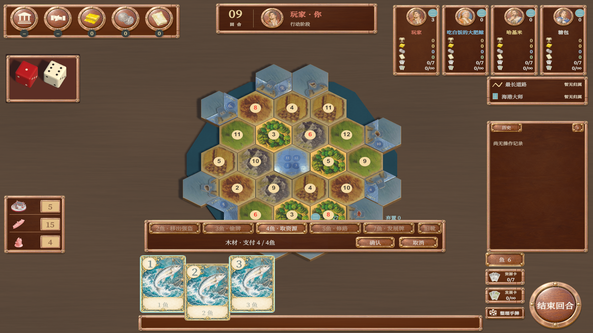
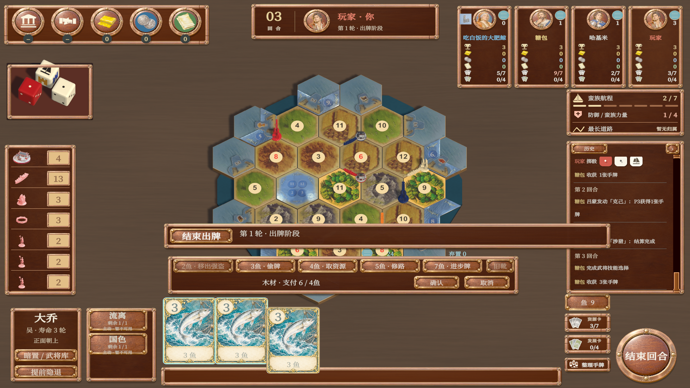
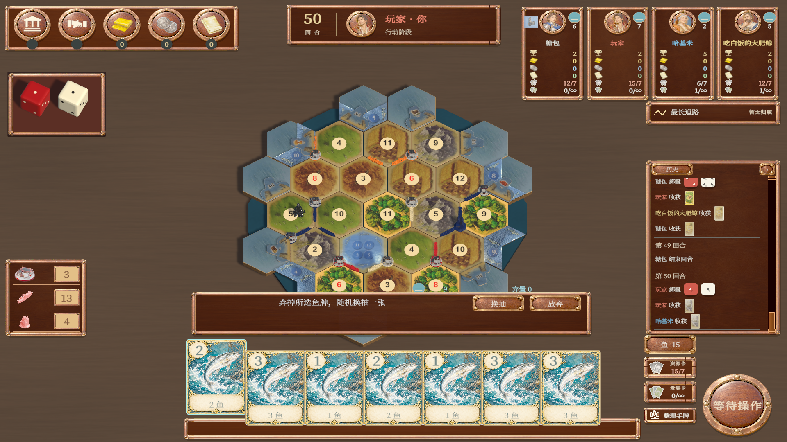

# 独立鱼手牌区验收

日期：2026-11-01。版本：内测版2.1.1，未发布或部署。

## 实现

- 基础、航海、城市骑士及双扩展接入同一鱼手牌页签。鱼牌与资源手牌共用108×151逻辑尺寸，保留每枚鱼的稳定身份及整张支付规则。
- 鱼操作位于手牌上方；选择行动后自动建议支付，可点击鱼牌取消／补选，选中牌抬起描边。确认前只维护本地草稿。
- 换抽待决自动切入鱼区；资源／发展页签取消鱼操作草稿；弃牌与武将手牌选择优先显示对应手牌。
- 三国阶段栏随鱼页签上移132逻辑单位，绘制及输入阻挡区域一起变更；发展卡购买按钮移至普通手牌上方，避免占用鱼页签。
- 原图、生成方式和完整提示词见[牌面制作](牌面制作.md)。没有新增网络请求、修改规则核心、存档或隐藏信息投影。

## 验证

Unity 6000.3.25f1编辑器编译通过。复用并更新`FishingF6EditorVerification`，通过Unity原生GameView事件执行：

- 桌面1440×900：基础版支付预览、取消、确认和右键说明通过。
- 最终移动端预览1920×1080：基础版和城市骑士鱼／资源／发展页签切换，点鱼牌取消及恢复支付选择，右键／长按说明，预览和取消不修改权威状态，确认取得资源均通过。
- 三国城市骑士：阶段栏避让断言、鱼支付确认通过；人工审看截图确认阶段栏没有覆盖支付按钮和牌面。
- 正常合法命令推进至满额换抽，保存恢复保持权威状态一致；选择鱼牌不提前扣鱼，确认结束本席待决并通过状态不变量检查。
- 先前全量界面回归也打开四模式默认／俯视地图；最终避让修复仅重跑相关手牌路径，使用`--fish-hand-only`跳过重复地图检查。
- 本轮代码与文档差异空白检查通过。工作区原有大量资产`.meta`改动未纳入本次提交。

最终检查原始结果见[检查结果](检查结果.json)。过程中修正了旧验收脚本的移动端等比留边坐标假设，以及截图审查发现的三国阶段栏遮挡，最终修复后重新验证通过。最终日志为`.local/fish-hand-final.log`。

未验证Android真机、物理触控、多设备联机及用户整局试玩；本轮未修改网络路径，没有扩大运行联机测试。未生成发布安装包。

## 实际截图

