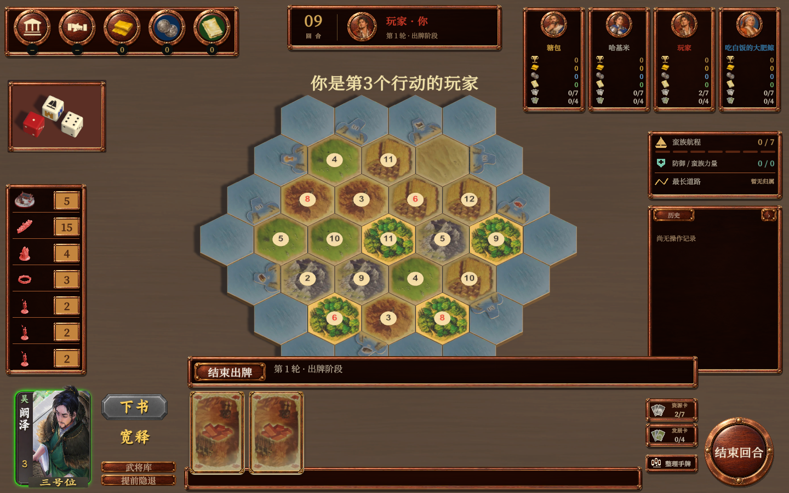

# 阚泽武将框接入预览

2026-11-02，按用户「只需要接入一个武将看效果」的要求，仅对阚泽（tk-g26）启用新外观。其他武将保持原界面。素材源、指纹保存在 `art/generated/general-frame/v001/皮肤来源.json`，导入工具为 `tools/art/Import-GeneralFrame.ps1`。

武将框使用已生成图集的区域采样，主动按钮使用去字后的四态图集，实际技能名称由本地BKJT字体动态绘制。立绘保留原透明通道，头部越过卡框上沿。位置来自实际玩家行动顺序，寿命保留在左侧下方，身份标识与手牌样式没有加入。

## 实际验证

通过已有 `B45InteractionEditorVerification.Run` 配合 `--general-frame-preview` 准备城市骑士四人三国局面，运行真实M6游戏界面。27项检查通过，产生3张1440×900实际游戏截图。

- 阚泽图片和技能底板能从Resources加载。
- 「下书」有手牌时可左击进入真实技能草稿；无手牌时左击不改变状态。
- 「宽释」左击不进入草稿、不改变权威存档；右击显示技能说明、不改变权威存档。
- 露头、竖排姓名、位置标识、主动按钮、被动金字的截图已人工审看。

另见 [主动选中](阚泽-主动技能选中.png)、[主动不可用](阚泽-主动技能不可用.png) 和 [结果](result.json)。结果原始通用说明沿用旧检查器措辞；本次没有执行其中提到的“五项技能及支付”全套流程，实际范围仅以上列出的单将预览检查。

首次预览发现工程当前目标为Android，旧GameView工具向Standalone分组添加尺寸，导致画面使用了错误的竖屏尺寸。已修正检查器按当前构建目标选择分组，重新检查通过。首次候选大乔有两个主动技能，因此最终选择同时具备主动与被动触发技能的阚泽；没有改变任何技能分类或规则。

编辑器启动日志有Unity Search索引与UIElements内部诊断；最终运行没有本次组件异常。未做正式构建、网络回归或Android真机测试，版本仍为内测版2.1.2。场景为编辑器指定局面，不能作为完整对局验收。
