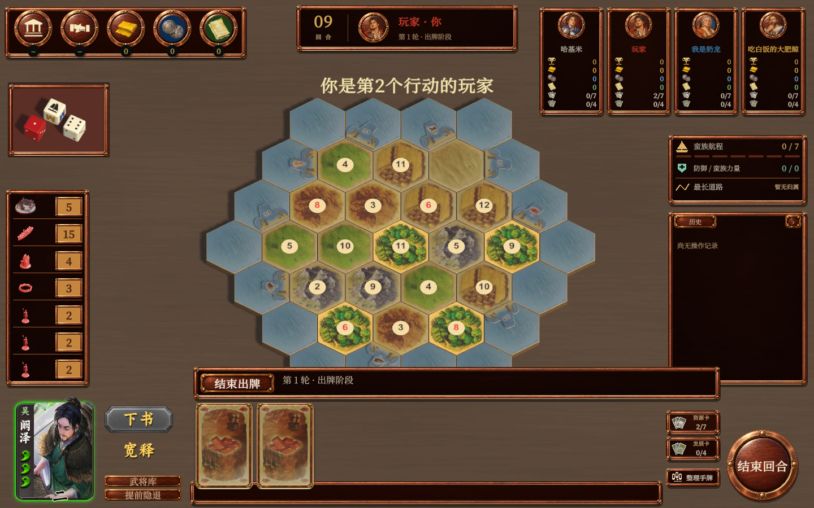
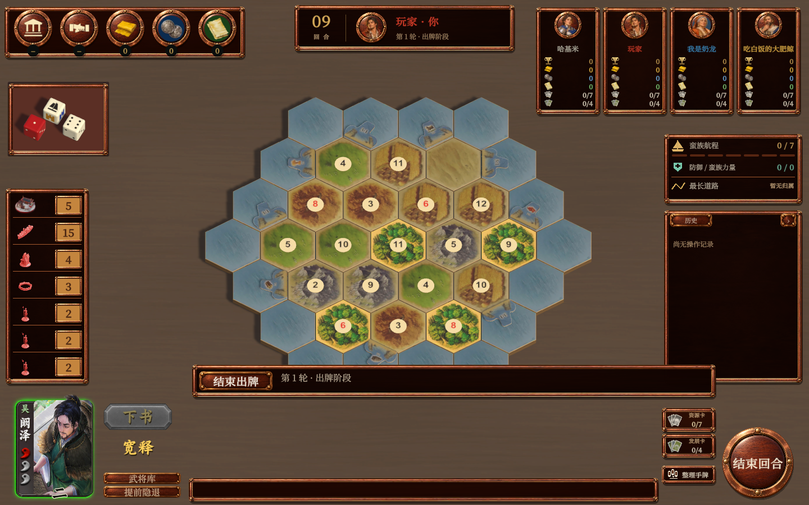
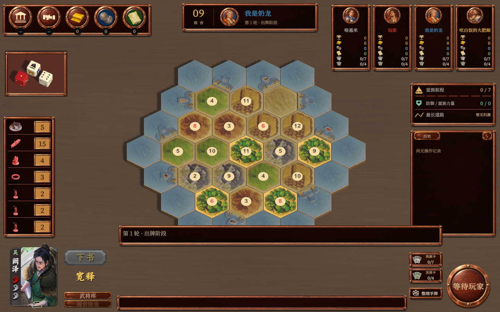

# 阚泽勾玉与回合高亮预览

2026-11-02，仅阚泽预览卡应用。本地无名杀的经典勾玉原图已导入 `Resources/GeneralUI/v001/hp-*.png`，完整来源与指纹见 `art/generated/general-frame/v001/勾玉来源.json`。原文件未修改。

采用项目现有3轮寿命：满值3枚绿玉；2轮显示2枚黄玉与1枚灰玉；1轮显示1枚红玉与2枚灰玉；零值全部灰玉。没有血量数字或分数。底边位置以黑色浅描边中文数字表示，去掉“号位”底板。高亮只跟随本人准备至结束阶段，不跟随悬停或临时操作响应。

复用 `B45InteractionEditorVerification.Run --general-frame-preview` 的真实Unity GameView夹具，33项检查通过，输出见 [结果](result.json)。检查主动技能可用／不可用、被动技能左击不发动与右击说明；截图覆盖满值、2轮、1轮和其他玩家回合。已审看低值勾玉与他人回合截图，无数字、无他人回合高亮。指定局面用于外观预览，不代表完整对局或Android真机验收。

版本维持内测版2.1.2，未构建或发布。
