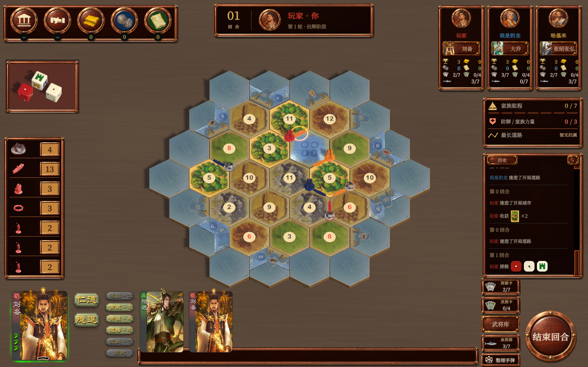
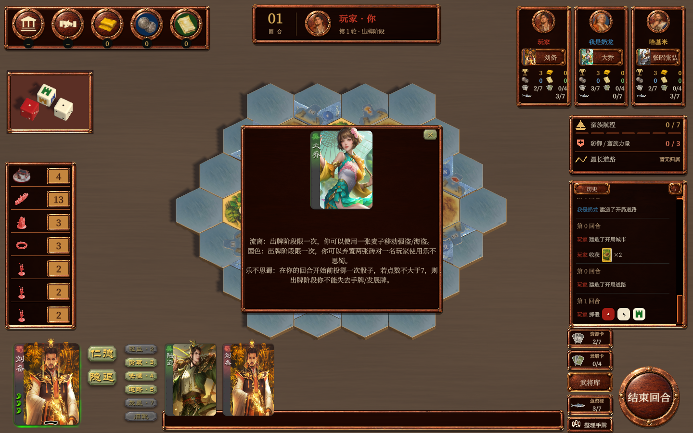
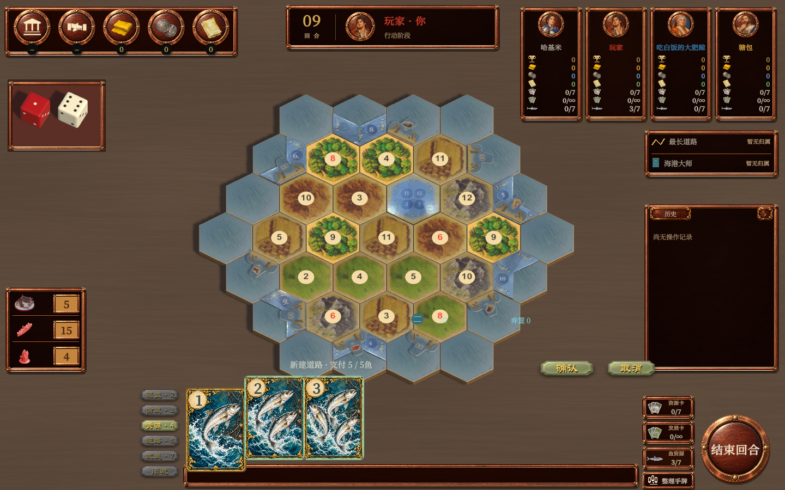

# 2.1.4 武将与捕鱼交互验收

日期：2026-11-03。版本：内测版2.1.4。

## 改动

- 删除武将占位说明和旧文字武将库。选将共用立绘与完整技能说明卡；武将库入口位于鱼资源上方，切换后在手牌区显示自己的暗置及在场武将，点击打开详情。
- 玩家姓名下增加公开在场武将卡片按钮；只能读取人类投影中已公开的武将，不展示对方暗置武将。
- 当前B6包主动隐退不抽取候选；已有暗置武将可登场，耗尽后留空且不再提供隐退命令。系统在第3、6、9……轮末统一补发。生命周期清理、联盟归还骑士和存档校验共同处理空在场状态；历史B4及更早包保持原路径。
- 玩家选择改用头像和姓名，发展类别改用对应颜色牌背；获授权选择具体牌时使用牌面。删除待决窗口的重复玩家说明行，强盗受害者只列合法候选。
- 鱼效果独立放在武将技能右列。固定确认条的绘制与命中位置，鱼建路先选地图落点再确认；任意资源复用金矿资源窗口。取消不提交。
- 按钮文字按内容区测量、缩放并居中；技能提示文字居中。武将技能列按技能数量分配高度，避免滚动条挤压按钮。
- 版本保留脚本改为按二级版本分别保留最近5份，不跨版本清理。当前未超过5份；自动审批拒绝旧目录移动与清理，保留旧目录。

规则依据：隐退与三轮补发采用本次用户明确要求；捕鱼成本及效果未更改，沿用本地 `TB25.pdf` 第9—10页与项目F0合同。

## 已完成检查

- 相关规则首轮37项通过，补充相关路径168项通过；最终隐退、空在场、第三轮补发、存档恢复及联盟归还专项18项通过。三个集合有重叠，不累加为独立检查数。结果位于 `.local/verification/interaction-213/`。
- 捕鱼真实GameView检查通过：资源选择、取消、领取、道路确认按钮单次提交、鱼牌右键及地图草稿。道路按钮采用隔离回调验证输入，实际规则效果由规则测试覆盖，不把它记为物理鼠标完整建路。
- 三国真实GameView检查通过：新局选将显示、武将库页签、手牌武将详情、其他玩家武将详情、切回资源手牌。四张截图已审看。
- Windows交互构建（版本号调整前）四种配置通过：20次保存恢复、8次主动隐退。该隐藏窗口运行没有生成截图，图像验收单独采用上述GameView截图。
- 构建程序集改为同目录临时文件、原子替换和完整哈希校验；已映射DLL替换专项通过。
- 新旧主路径验证器已随布局调整；本次没有重复运行全部历史F6流程。Android真机和四设备外网未验证。

## 画面证据

## 构建

构建目录：`game version/2.1/Catan2.1.4-General-Fishing-Interaction`。
Windows主程序及Android ARM64包均命名为 `Catan2.1.4`。最终构建与签名结果见同目录 `logs`。本轮未正式发布或部署云端。

共享项目已有并行更新升至2.1.4，本轮沿用当前版本；PC重新构建通过，Android包签名通过。
